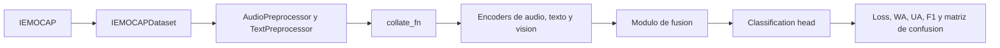

# Arquitectura y flujos del proyecto

Esta guía resume cómo está conectado el código actual de **CONFORMER-SER**. El objetivo es evitar confusiones entre el flujo baseline, las ablaciones, la evaluación de ensembles y la evaluación directa de checkpoints ya entrenados.

## Mapa rápido

| Necesidad | Entrada recomendada | Observaciones |
|-----------|---------------------|---------------|
| Entrenar modelo base | `python src\train.py --config config\config.yaml --device cuda` | Usa `ConformerMultimodalModel` o `AudioOnlyModel`. |
| Entrenar una ablación | `python scripts\run_ablation.py --study N --device cuda` | Usa `create_ablation_model()` y YAML de `config\ablation\`. |
| Evaluar modelo base | `python src\evaluate.py --checkpoint <best_model.pt> --config config\config.yaml --split test --device cuda` | No es el flujo recomendado para checkpoints de ablación. |
| Evaluar una ablación por YAML | `python src\evaluate_ensemble.py --checkpoints <ckpt> --configs <yaml> --study_numbers N --weights 1.0 --split test --device cuda` | Sirve para un modelo o para varios modelos en ensemble. |
| Evaluar solo test de un run guardado | `python scripts\run_test_only.py --checkpoint_dir <run_dir_o_best_model.pt> --study N --device cuda` | Carga `config.json` y escribe `final_results.json` en el mismo directorio. |
| Inferencia de un archivo | `python src\inference.py --checkpoint <ckpt> --audio <wav> --text "texto"` | Orientado al modelo base, no a todas las ablaciones. |

## Flujo de datos



El paquete `src.data` aporta `IEMOCAPDataset`, preprocesadores y funciones `collate`. Los modelos reciben **audio crudo** a 16 kHz y tokens de texto. En estudios trimodales, el ViT no lee mel desde el disco: el **log-mel se calcula dentro del modelo** a partir de ese waveform (p. ej. `Ablation11Model._waveform_to_vit_image`); no existe en el dataset un campo aparte de “características mel”.

## Entrenamiento baseline

El flujo base vive en `src/train.py`:

- `create_dataloaders()` crea train/val/test.
- `create_model()` instancia `ConformerMultimodalModel` o `AudioOnlyModel`.
- `train_epoch()` y `validate()` implementan entrenamiento y validación.
- Los checkpoints, logs y curvas se guardan según la sección `logging` de la config.

Comando típico:

```powershell
python src\train.py --config config\config.yaml --experiment_name baseline --device cuda
```

Usa este camino cuando trabajes con la arquitectura declarada en `config/config.yaml`.

## Entrenamiento de ablaciones

El flujo de investigación está en `scripts/run_ablation.py`:

- `load_ablation_config()` fusiona la configuración base con el YAML de `config/ablation/`.
- `create_ablation_model(study_number, config, device, logger)` mapea cada estudio a su clase de modelo.
- Estudios especiales como LOSO o K-Fold tienen ramas dedicadas.
- Antes de evaluar en test, el script carga el mejor checkpoint (`best_model.pt`) para evitar evaluar la última época si no fue la mejor.

Comando típico:

```powershell
python scripts\run_ablation.py --study 34 --device cuda
```

El listado canónico de estudios y YAML está en `config/ablation/ABLATION_SUMMARY.md` y en la lista `studies` de `scripts/run_ablation.py`.

## Modelos y fusiones principales

| Área | Rutas clave | Rol |
|------|-------------|-----|
| Modelo base | `src/models/conformer.py` | Encoders audio/texto/vision y fusión configurable para el baseline. |
| Fusiones | `src/models/fusion.py` | Concat, cross-attention, gated, tensor, jerárquica, bilinear, GLU, Conflict-Aware y Gated Interactive Attention. |
| Ablaciones | `src/ablation_studies/ablation_*_model.py` | Variantes por estudio y extensiones sobre modelos previos. |
| Cabezas | `src/ablation_studies/classification_heads.py` | MLP, LSTM, Transformer, CNN1D y MultiScaleTemporal. |
| Optimizador de ablaciones | `src/ablation_studies/utils.py` | Grupos de learning rate por encoder, fusión, classifier y parámetros especiales. |
| Losses | `src/utils/losses.py` | Cross entropy, focal, Dirichlet, contrastive/composite loss según config. |
| Métricas | `src/utils/metrics.py` | WA, UA, F1, métricas por clase y matriz de confusión. |

## Evaluación

### `src/evaluate.py`

`src/evaluate.py` reconstruye el modelo base desde `config/config.yaml`. Es útil para checkpoints del flujo `src/train.py`, pero no conoce automáticamente todas las clases de `src/ablation_studies`.

```powershell
python src\evaluate.py --checkpoint checkpoints\best_model.pt --config config\config.yaml --split test --device cuda
```

### `src/evaluate_ensemble.py`

`src/evaluate_ensemble.py` sí usa el mecanismo de ablaciones y permite evaluar uno o varios checkpoints:

```powershell
python src\evaluate_ensemble.py `
  --checkpoints checkpoints\ablation_34\run\best_model.pt `
  --configs config\ablation\ablation_34_conflict_aware_attention.yaml `
  --study_numbers 34 `
  --weights 1.0 `
  --split test `
  --output_dir evaluation_results\ablation_34 `
  --device cuda
```

Para ensemble, pasa varias rutas en `--checkpoints`, varias configs en `--configs`, varios estudios en `--study_numbers` y pesos alineados en `--weights`.

### `scripts/run_test_only.py`

Este script es el camino más directo cuando ya existe un directorio de run con:

- `best_model.pt`
- `config.json`
- opcionalmente `best_metrics.json`

Ejemplo:

```powershell
python scripts\run_test_only.py --checkpoint_dir checkpoints\phase1_wavlm_gated\ablation_34_20260203_094355 --study 34 --device cuda
```

También acepta una ruta directa a `best_model.pt`; en ese caso usa el directorio padre. El resultado se guarda en el mismo directorio:

- `final_results.json`
- `confusion_matrix_test.png`
- `test_eval.log`

## Checkpoints y resultados

La estructura habitual de un run es:

```text
checkpoints/
└── ablation_XX/
    └── ablation_XX_YYYYMMDD_HHMMSS/
        ├── best_model.pt
        ├── config.json
        ├── best_metrics.json
        ├── final_results.json
        ├── confusion_matrix_test.png
        └── training_curves.png
```

`final_results.json` debe reflejar métricas de test del mejor checkpoint, no necesariamente de la última época entrenada.

## Reglas prácticas

- Para reproducir una ablación, usa siempre `scripts/run_ablation.py --study N`.
- Para evaluar un checkpoint de ablación sin reentrenar, usa `scripts/run_test_only.py` si tienes `config.json`; usa `src/evaluate_ensemble.py` si quieres pasar YAML explícito.
- Para comparar varios modelos, usa `src/evaluate_ensemble.py`.
- Para cambiar rutas de dataset, edita `dataset.data_path` en `config/config.yaml` o en el YAML de ablación correspondiente.
- Para el estudio 50 (y variantes con Emotion2Vec, p. ej. 57) puede requerirse `funasr`, según el encoder configurado.
- El código actual lista estudios `1-50` y `52-65`; el estudio 51 no está definido en `scripts/run_ablation.py`.
- Algunos YAML de `config/ablation/` (p. ej. `ablation_65_unfrozen_vit.yaml`) **no tienen ruta de código** y no son ejecutables.

