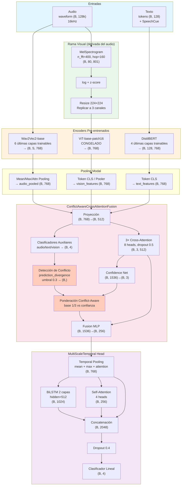

# Ablation 45: Documentación Arquitectónica de Profundidad
## Conflict-Aware Cross-Attention Trimodal + MultiScaleTemporal Classification Head

**Estado:** SOTA del proyecto (serie 34-45)  
**Clase:** `Ablation34Model` (vía `scripts/run_ablation.py`, study 45)  
**Config:** `config/ablation/ablation_45_multiscale_head.yaml`  
**Base evolutiva:** Ablation 34 (Conflict-Aware Cross-Attention) + Ablation 25 (Enhanced Cross-Attention) + Ablation 13c (ViT parcialmente descongelado) + Ablation 11 (rama visual derivada del waveform)

---

## 1. Resumen Ejecutivo

El Ablation 45 representa la convergencia de tres líneas de investigación independientes en el reconocimiento multimodal de emociones:

1. **Fusión profunda con mecanismos de atención cruzada** (serie 20-28), donde cada modalidad atiende explícitamente a las demás.
2. **Detección y resolución de conflictos inter-modales** (Ablation 34), que aborda la inconsistencia intrínseca entre señales emocionales (p. ej., texto "feliz" + entonación enfadada).
3. **Modelado temporal multiescala** (Ablation 45 propiamente dicha), que sustituye la cabeza LSTM estándar por una arquitectura que extrae representaciones temporales en múltiples granularidades antes de la clasificación final.

El resultado es un modelo **trimodal** (audio + texto + visión) que no solo fusiona información, sino que **razona explícitamente sobre la confiabilidad relativa de cada modalidad** cuando detecta contradicciones, y que **captura patrones temporales en múltiples escalas** antes de emitir una predicción.

---

## 2. Contexto y Motivación del Diseño

### 2.1 Problema: La inconsistencia multimodal en SER

En el reconocimiento de emociones del habla (Speech Emotion Recognition, SER), las tres modalidades principales no siempre están alineadas:

- **Audio (prosodia):** Captura la entonación, el tono, la energía y el ritmo. Es robusta ante ambigüedades léxicas, pero vulnerable al ruido acústico y a la variabilidad del locutor.
- **Texto (contenido léxico):** Proporciona contexto semántico explícito. Sin embargo, el texto puede ser neutral mientras la prosodia revela enfado (sarcasmo), o viceversa.
- **Visión (log-mel espectrograma):** Ofrece una representación visual de la distribución espectral-temporal del audio. Complementa al audio brindando información sobre formantes y patrones espectrales que el encoder acústico puede subrepresentar.

La hipótesis central del Ablation 45 es que **un modelo de fusión multimodal debe ser explícitamente consciente de los conflictos entre modalidades**, y debe **ponderar dinámicamente** cada fuente en función de su confianza relativa, en lugar de fusionar ciegamente.

### 2.2 Evolución desde el baseline hasta el SOTA

| Ablation | Contribución principal | UA (referencia) |
|----------|------------------------|-----------------|
| 01-04 | Exploración de cabezas de clasificación | ~70% |
| 05-07 | Estrategias de fine-tuning parcial | - |
| 10-12 | Incorporación de SpeechCue y rama visual (ViT) | - |
| 13c | ViT congelado + fusión trimodal base | ~73% |
| 25 | Enhanced Cross-Attention (múltiples capas) | 77.44% |
| 34 | **Conflict-Aware Cross-Attention** | **77.98%** |
| 45 | **Conflict-Aware + MultiScaleTemporal Head** | **SOTA** |

El Ablation 45 se construye sobre el Ablation 34, que ya había demostrado que la detección de conflictos mejora la robustez. La innovación del 45 reside en reemplazar la cabeza LSTM estándar (que procesa el vector fusionado como una secuencia de longitud 1) por una cabeza **MultiScaleTemporal** que explícitamente:

1. Genera múltiples representaciones de pooling temporal (mean, max, attention).
2. Procesa estas representaciones como una secuencia temporal mediante LSTM bidireccional.
3. Aplica self-attention sobre la secuencia de representaciones para capturar interacciones entre escalas.
4. Concatena todas las representaciones antes de la clasificación final.

---

## 3. Arquitectura Global

```
Entrada:
  ├── Audio: waveform crudo (16 kHz, ~8s max)
  ├── Texto: transcripción tokenizada (DistilBERT, max 128 tokens)
  └── Visión: log-mel espectrograma derivado del MISMO waveform → imagen 224×224

Encoders pre-entrenados:
  ├── Audio:  facebook/wav2vec2-base  (768-dim, 12 capas transformer)
  ├── Texto:  distilbert-base-uncased (768-dim, 6 capas transformer)
  └── Visión: google/vit-base-patch16-224 (768-dim, 12 capas transformer)

Estrategia de fine-tuning:
  ├── Audio:  últimas 6 capas descongeladas
  ├── Texto:  últimas 4 capas descongeladas
  └── Visión: congelado (freeze_vision_encoder=true)

Fusión:
  └── ConflictAwareCrossAttentionFusion
      ├── Proyección a espacio común (512-dim)
      ├── Clasificadores auxiliares por modalidad (detección de conflicto)
      ├── 3 capas de cross-attention (8 cabezas, dropout 0.5)
      ├── Detección de conflicto: prediction_divergence (umbral 0.3)
      ├── Red de confianza (confidence_net)
      ├── Ponderación conflict-aware
      └── Fusion MLP (512 → 256-dim)

Cabeza de clasificación:
  └── MultiScaleTemporalClassificationHead
      ├── Temporal Pooling: mean + max + attention
      ├── LSTM bidireccional (2 capas, hidden=512, dropout 0.3)
      ├── Self-Attention (4 cabezas)
      ├── Dropout final (0.4)
      └── Clasificador lineal (concatenación → 4 clases)

Entrenamiento:
  ├── Loss: CrossEntropy con label_smoothing=0.1
  ├── Optimización: Adam (tres grupos de LR)
  ├── Batch: 4 × 8 acumulación = efectivo 32
  └── 100 épocas, early stopping patience=8
```

---

## 4. Pipeline de Entrada y Preprocesamiento

### 4.1 Audio

- **Formato:** Waveform crudo, 16 kHz, mono.
- **Longitud máxima:** 8 segundos (`max_length: 8`).
- **Aumentación de waveform (entrenamiento):**
  - `time_masking`: máscara temporal con probabilidad 0.5, hasta 4000 muestras.
  - `noise`: SNR entre 10-30 dB, probabilidad 0.3.
  - `speed_perturb`: rango [0.9, 1.1], probabilidad 0.3.
  - `pitch_shift`: ±2 semitonos, probabilidad 0.2.
- **Procesamiento:** El waveform pasa directamente al encoder Wav2Vec2, que internamente:
  - Aplica convoluciones de feature extraction (7 capas CNN con progresión 10ms→20ms).
  - Genera representaciones de frame cada 20ms.
  - Aplica positional embeddings convolucionales.
  - Pasa por 12 capas transformer con conexiones residuales.

### 4.2 Texto

- **Encoder:** DistilBERT-base-uncased (66M parámetros, 6 capas transformer).
- **Tokenización:** WordPiece, máximo 128 tokens.
- **SpeechCue:** El dataset pipeline inyecta cues prosódicos en el texto (marcadores de entonación, pausas, energía) cuando `use_prosody_cues: true`. Esto enriquece la entrada textual con información derivada del audio antes de que llegue al modelo.
- **Aumentación textual:** Máscara aleatoria de tokens con probabilidad 0.15 (desactivada por `apply_text_augment: false` en esta config).

### 4.3 Visión (Rama derivada del waveform)

Esta es una decisión arquitectónica crucial: **la rama visual no consume una modalidad separada, sino que deriva una vista espectral del mismo audio**.

**Flujo:**
1. **Mel-spectrograma:** Se calcula en el `forward` del modelo usando `torchaudio.transforms.MelSpectrogram`:
   - `n_fft=400`, `hop_length=160`, `win_length=400`, `n_mels=80`.
   - Normalizado (`normalized=True`).
2. **Escala logarítmica:** `log(mel + 1e-9)`.
3. **Normalización por muestra:** z-score `(mel - mean) / (std + 1e-9)`.
4. **Resize:** Interpolación bilineal a `224×224` para ViT.
5. **Replicación de canales:** El espectrograma de 1 canal se replica a 3 canales `(R=G=B)` para compatibilidad con ViT pre-entrenado en ImageNet.
6. **ViT:** `google/vit-base-patch16-224` procesa la "imagen" espectral y emite un vector CLS de 768 dimensiones.

**Justificación:** El log-mel es una representación interpretable por humanos que exhibe patrones visuales (armónicos, formantes, trazas de pitch). Un ViT pre-entrenado en imágenes naturales puede transferir su capacidad de detectar patrones espaciales a estas estructuras espectrales, actuando como un **complemento perceptual al encoder acústico Wav2Vec2**, que opera en el dominio del waveform.

---

## 5. Encoders Pre-entrenados y Estrategias de Fine-tuning

### 5.1 Wav2Vec2-base (Audio)

- **Arquitectura:** 7 capas CNN feature extractor + 12 capas transformer (768-dim, 12 heads).
- **Pre-entrenamiento:** Self-supervised en LibriSpeech (960h de audio).
- **Estado en el modelo:** `freeze_audio_encoder: false`, pero con `audio_unfreeze_last_n_layers: 6`.
- **Significado:** Las primeras 6 capas transformer están congeladas. Las últimas 6 se entrenan.
- **Razón:** Las capas bajas de Wav2Vec2 capturan fonética y fonología; las capas altas capturan prosodia, entonación y estilo. Al descongelar solo las capas altas, evitamos el catastrophic forgetting de representaciones fonéticas robustas mientras adaptamos el modelo al dominio emocional.

### 5.2 DistilBERT-base (Texto)

- **Arquitectura:** 6 capas transformer (768-dim, 12 heads), destilado de BERT-base.
- **Pre-entrenamiento:** Masked language modeling en corpus inglés general.
- **Estado:** `freeze_text_encoder: false`, `text_unfreeze_last_n_layers: 4`.
- **Significado:** Las últimas 4 de 6 capas se entrenan; las primeras 2 permanecen congeladas.
- **Razón:** Las capas bajas de BERT codifican morfología y sintaxis local; las capas altas capturan semántica y pragmática contextual. En SER, la emoción a menudo reside en matices pragmáticos y contextuales que las capas altas modelan mejor.

### 5.3 ViT-base-patch16-224 (Visión)

- **Arquitectura:** 12 capas transformer (768-dim, 12 heads), patches de 16×16.
- **Pre-entrenamiento:** Supervisado en ImageNet-21k.
- **Estado:** `freeze_vision_encoder: true` (totalmente congelado).
- **Razón:** La rama visual es una fuente complementaria, no primaria. Congelar el ViT previene overfitting en el dominio espectral (el dataset es pequeño: ~5.5k utterances). La representación genérica de patrones espaciales aprendida en ImageNet es suficientemente transferible. Además, el ViT es computacionalmente caro; congelarlo reduce drásticamente el costo de entrenamiento y memoria.

---

## 6. Módulo de Fusión: ConflictAwareCrossAttentionFusion

Este es el núcleo intelectual del modelo. A diferencia de las fusiones por concatenación o atención cruzada estándar, este módulo **detecta activamente cuándo las modalidades se contradicen** y **ajusta sus pesos de fusión en consecuencia**.

### 6.1 Arquitectura interna

```python
ConflictAwareCrossAttentionFusion(
    audio_dim=768, text_dim=768, vision_dim=768,
    hidden_dim=512,
    num_classes=4,
    num_heads=8,
    num_layers=3,
    dropout=0.5,
    conflict_threshold=0.3,
    conflict_detection_method="prediction_divergence"
)
```

#### 6.1.1 Proyección a espacio común

Cada modalidad se proyecta de 768-dim a 512-dim mediante capas lineales independientes:
- `audio_proj: nn.Linear(768, 512)`
- `text_proj: nn.Linear(768, 512)`
- `vision_proj: nn.Linear(768, 512)`

**Razón:** Aunque los tres encoders coinciden en 768-dim en este caso, las proyecciones permiten:
1. Flexibilidad para cambiar encoders (p. ej., WavLM-large=1024, RoBERTa-base=768).
2. Aprender una rotación/discriminación del espacio de embeddings hacia una representación optimizada para la tarea de fusión.
3. Desacoplar la dimensión de fusión (`hidden_dim=512`) de la dimensión de los encoders, reduciendo la complejidad computacional de las capas de atención.

#### 6.1.2 Clasificadores auxiliares por modalidad

```python
self.audio_classifier = nn.Linear(512, 4)
self.text_classifier = nn.Linear(512, 4)
self.vision_classifier = nn.Linear(512, 4)
```

Estos clasificadores "débiles" generan predicciones independientes por modalidad **antes** de la fusión. Sus logits son utilizados exclusivamente para la detección de conflicto, no para la clasificación final.

**Inicialización:** Pesos inicializados con `N(0, 0.01)` — muy pequeños para evitar sesgos iniciales fuertes que induzcan falsos conflictos al inicio del entrenamiento.

**Razón:** Si un clasificador auxiliar predice clase A y otro predice clase B para la misma muestra, el modelo infiere que hay una discrepancia genuina entre modalidades que debe resolverse ponderadamente, no promediando.

#### 6.1.3 Cross-Attention Layers

```python
self.cross_attn_layers = [
    nn.MultiheadAttention(embed_dim=512, num_heads=8, dropout=0.5, batch_first=True)
    for _ in range(3)
]
```

Las tres modalidades se apilan como una secuencia de 3 tokens: `(B, 3, 512)`.
Cada capa aplica **self-attention** sobre estos 3 tokens (que, dado que provienen de modalidades distintas, funciona como cross-attention implícita).

**Mecánica matemática:**
```
Para cada capa l:
  Q = K = V = tokens  # (B, 3, 512)
  attn_out = MultiheadAttention(Q, K, V)  # (B, 3, 512)
  tokens = LayerNorm(tokens + attn_out)   # Residual + Pre/Post-norm
```

**Por qué 3 capas:** Una sola capa permite que cada token "vea" a los otros dos, pero no permite interacciones de orden superior (p. ej., "el audio atiende al texto que ya ha sido modulado por la visión"). Con 3 capas, la información puede circular varias veces entre las tres modalidades, permitiendo refinamiento iterativo.

**Por qué 8 cabezas:** Cada cabeza puede especializarse en diferentes tipos de relaciones intermodales (p. ej., una cabeza para alineación temporal, otra para correlación semántica, otra para detección de sarcasmo).

#### 6.1.4 Detección de Conflicto: `prediction_divergence`

```python
def _detect_conflict_prediction_divergence(audio_logits, text_logits, vision_logits):
    audio_pred = argmax(audio_logits)  # (B,)
    text_pred = argmax(text_logits)    # (B,)
    vision_pred = argmax(vision_logits) # (B,)
    
    # Discrepancia por pares
    d_at = (audio_pred != text_pred).float()
    d_av = (audio_pred != vision_pred).float()
    d_tv = (text_pred != vision_pred).float()
    
    # Conflicto si al menos DOS pares discrepan
    conflict = (d_at + d_av + d_tv) >= 2.0
    return conflict.float()  # (B,)
```

**Análisis de la lógica:**
- Si solo un par discrepa (p. ej., audio=texto ≠ visión), no se considera conflicto grave. Podría ser que dos modalidades "acuerdan" y la tercera es ruido.
- Si dos o tres pares discrepan, significa que las tres modalidades están en desacuerdo (cíclico) o que dos están de acuerdo contra una tercera que predice algo distinto... pero espera, si audio≠texto, texto≠visión, y audio≠visión, son tres pares discrepantes → conflicto. Si audio=texto pero ambos ≠ visión, solo un par discrepa → NO conflicto. Esto es una decisión conservadora: **sólo actuamos cuando hay un desacuerdo masivo**.

**Umbral implícito:** No hay umbral continuo en `prediction_divergence`; es binario. El parámetro `conflict_threshold=0.3` solo aplica a los otros métodos (`feature_distance` y `learned`).

**Ventajas de `prediction_divergence`:**
- Interpretable: un humano puede entender por qué el modelo detectó conflicto.
- Sin parámetros adicionales: no requiere entrenar un detector de conflicto.
- Robusto: no depende de la geometría del espacio de embeddings.

**Desventajas:**
- Binario: no captura grados de conflicto.
- Depende de la calidad de los clasificadores auxiliares: si son malos al inicio, pueden generar ruido.
- Ignora la confianza de las predicciones: un clasificador puede predecir clase A con 51% y B con 49%, lo cual es casi un empate, pero `prediction_divergence` lo trata como una predicción firme.

#### 6.1.5 Red de Estimación de Confianza

```python
self.confidence_net = nn.Sequential(
    nn.Linear(512 * 3, 512),
    nn.LayerNorm(512),
    nn.GELU(),
    nn.Dropout(0.5),
    nn.Linear(512, 3),
    nn.Sigmoid(),  # Salida en (0, 1) por modalidad
)
```

Toma los 3 tokens refinados por la cross-attention, los aplana `(B, 1536)`, y emite un score de confianza para cada modalidad.

**Razón:** Después de la cross-attention, los tokens han sido enriquecidos con información de las otras modalidades. La red de confianza evalúa, para cada muestra del batch, qué tan "coherente" o "útil" es cada modalidad en el contexto de las demás.

#### 6.1.6 Ponderación Conflict-Aware

```python
# Pesos base: uniformes (1/3 cada uno)
base_weights = torch.ones(B, 3) / 3.0

# Pesos por confianza (normalizados)
conflict_weights = confidence_scores / (confidence_scores.sum(dim=-1, keepdim=True) + 1e-8)

# Interpolación basada en máscara de conflicto
conflict_mask = conflicts.unsqueeze(-1)  # (B, 1)
final_weights = (1 - conflict_mask) * base_weights + conflict_mask * conflict_weights
```

**Lógica:**
- **Sin conflicto:** Se usan pesos uniformes (1/3, 1/3, 1/3). El modelo confía en la fusión simétrica.
- **Con conflicto:** Se usan los pesos derivados de la red de confianza. La modalidad con mayor confianza (mayor `confidence_score`) recibe más peso.

**Interpretación:** Esta es una forma de **mixture of experts** implícita, donde el "expert selector" es el detector de conflicto, y los "expert weights" son las confianzas.

#### 6.1.7 Fusion MLP

```python
self.fusion = nn.Sequential(
    nn.Linear(512 * 3, 512),
    nn.LayerNorm(512), nn.GELU(), nn.Dropout(0.5),
    nn.Linear(512, 512),
    nn.LayerNorm(512), nn.GELU(), nn.Dropout(0.4),  # dropout*0.8
    nn.Linear(512, 256),
    nn.LayerNorm(256), nn.GELU(), nn.Dropout(0.3),  # dropout*0.6
)
```

**Características:**
- Pirámide progresiva: 1536 → 512 → 512 → 256.
- Dropout decreciente: 0.5 → 0.4 → 0.3. Esto refleja la intuición de que cuanto más profunda es la red, menos regularización se necesita porque las representaciones son más abstractas y menos propensas a overfitting.
- GELU en lugar de ReLU: Mejor flujo de gradiente para representaciones pre-entrenadas.
- LayerNorm antes de la activación (post-norm en este diseño): Estabiliza las estadísticas del batch, especialmente importante dado el batch size pequeño (4).

### 6.2 Flujo de tensores en la fusión

```
Audio pooled:    (B, 768) ──audio_proj──► (B, 512)
Text CLS:        (B, 768) ──text_proj───► (B, 512)
Vision CLS:      (B, 768) ──vision_proj─► (B, 512)

Tokens:          (B, 3, 512)

Cross-Attn (×3): (B, 3, 512) ──► (B, 3, 512) [refinados]

Logits aux:      (B, 4) cada uno ──► Detección conflicto: (B,)
Confianza:       flatten(B, 1536) ──► (B, 3)

Pesos finales:   (B, 3)
Tokens pesados:  (B, 3, 512) * (B, 3, 1) = (B, 3, 512)
Flatten:         (B, 1536)
Fusion MLP:      (B, 1536) ──► (B, 256)
```

---

## 7. Cabeza de Clasificación: MultiScaleTemporalClassificationHead

Esta cabeza es la diferencia fundamental entre Ablation 34 y Ablation 45. Mientras que la cabeza LSTM estándar (Ablation 34) toma el vector fusionado `(B, 256)` y lo trata como una secuencia de longitud 1, la cabeza MultiScaleTemporal **construye múltiples representaciones del mismo vector** y las procesa como una secuencia temporal multiescala.

### 7.1 Arquitectura interna

```python
MultiScaleTemporalClassificationHead(
    hidden_dim=256,      # Dimensión de entrada (output de fusion MLP)
    num_classes=4,
    dropout=0.5,
    use_temporal_pooling=True,
    pooling_types=["mean", "max", "attention"],
    use_lstm=True,
    lstm_num_layers=2,
    lstm_bidirectional=True,
    lstm_hidden=512,
    lstm_dropout=0.3,
    use_self_attention=True,
    attention_heads=4,
    final_dropout=0.4,
)
```

### 7.2 Componentes detallados

#### 7.2.1 Temporal Pooling

El vector de entrada `(B, 256)` se replica como una secuencia de longitud 1: `(B, 1, 256)`. A partir de esta "secuencia unitaria", se generan 3 vectores de pooling diferentes:

1. **Mean pooling:** `x.mean(dim=1)` → `(B, 256)`
   - Captura el valor esperado de la representación.
2. **Max pooling:** `x.max(dim=1).values` → `(B, 256)`
   - Captura las características más salientes/activadas.
3. **Attention pooling:**
   ```python
   q = self.attn_query.expand(B, -1, -1)  # (B, 1, 256)
   out, _ = self.attn_pool(query=q, key=x, value=x)  # (B, 1, 256)
   ```
   - Un query aprendido (parámetro entrenable) consulta la secuencia y extrae una representación ponderada por atención.
   - Esto permite al modelo aprender **qué dimensiones del vector son más relevantes** para la tarea.

**Concatenación de pooling:** Si se usan los 3 tipos, se concatenan: `(B, 256 * 3) = (B, 768)`.

**Razón:** Diferentes operaciones de pooling capturan diferentes "facetas" de la información emocional:
- Mean: tendencia global del estado emocional.
- Max: picos de activación emocional (momentos de máxima expresividad).
- Attention: representación focalizada en las dimensiones más discriminativas.

#### 7.2.2 LSTM Bidireccional

```python
nn.LSTM(
    input_size=256,        # Cada token de la secuencia tiene 256-dim
    hidden_size=512,
    num_layers=2,
    batch_first=True,
    dropout=0.3,           # Entre capas (no aplicado en la última)
    bidirectional=True,
)
```

**Entrada:** Los vectores de pooling se apilan como una secuencia: `(B, 3, 256)`.

**Salida:** Los estados ocultos finales:
```python
h_forward = h[-2]   # Última capa, dirección forward
h_backward = h[-1]  # Última capa, dirección backward
h_concat = cat([h_forward, h_backward], dim=-1)  # (B, 1024)
```

**Razón:** Aunque la secuencia solo tiene 3 tokens, la LSTM modela las **transiciones y dependencias entre los diferentes tipos de pooling**. Por ejemplo, la combinación de "max + mean" puede indicar una emoción con alta variabilidad (picos altos pero media baja), mientras que "mean + attention" puede indicar una emoción consistente y focalizada.

**Por qué hidden=512 > input=256:** La LSTM necesita capacidad suficiente para transformar la secuencia corta en una representación rica. El sobredimensionamiento relativo (2×) es una práctica común en LSTMs para tareas de clasificación.

#### 7.2.3 Self-Attention sobre la secuencia de pooling

```python
nn.MultiheadAttention(
    embed_dim=256,
    num_heads=min(4, 256 // 4) = 4,  # 4 cabezas
    dropout=0.5,
    batch_first=True,
)
```

```python
attn_out, _ = self.self_attn(seq, seq, seq)  # (B, 3, 256)
attn_out = self.self_attn_norm(attn_out.mean(dim=1))  # (B, 256)
```

**Razón:** La self-attention permite que los diferentes tipos de pooling "se comuniquen" explícitamente. Por ejemplo, el token de max pooling puede aprender a suprimir información redundante del mean pooling, o el token de attention puede reforzar señales débiles pero importantes que mean pooling diluye.

**Nota:** Se toma la media sobre la dimensión de secuencia (3) antes de la LayerNorm, produciendo un vector de 256-dim.

#### 7.2.4 Concatenación y Clasificación Final

```python
combined_dim = pool_concat (768) + lstm_out (1024) + self_attn_out (256) = 2048

out = concat([pool_concat, lstm_out, self_attn_out], dim=-1)  # (B, 2048)
out = nn.Dropout(0.4)(out)
logits = nn.Linear(2048, 4)(out)
```

**Razón de la concatenación (no suma):** Cada componente captura información complementaria:
- Pooling: estadísticas descriptivas del vector de fusión.
- LSTM: dependencias secuenciales entre representaciones de pooling.
- Self-attention: interacciones directas entre representaciones de pooling.

La suma perdería información; la concatenación preserva todos los canales de información.

**Dropout final 0.4:** Alta regularización justificada por la dimensionalidad muy alta (2048) relativa al tamaño del dataset.

### 7.3 Ventajas de la cabeza MultiScaleTemporal sobre LSTM estándar

| Aspecto | LSTM estándar (Ablation 34) | MultiScaleTemporal (Ablation 45) |
|---------|------------------------------|-----------------------------------|
| Entrada | 1 token (B, 1, 256) | 3 tokens (B, 3, 256) |
| Pooling | Implícito (solo LSTM) | Explícito (mean, max, attention) |
| Capacidad | Secuencial | Secuencial + Atención |
| Dimensión final | 512 (bidir) | 2048 (concatenada) |
| Especialización | Generalista | Multiescala (estadística + secuencial + interacción) |

**Por qué funciona mejor:** La LSTM estándar recibe un único token de fusión y debe "inventar" la variabilidad temporal internamente. La cabeza MultiScaleTemporal **inyecta artificialmente variabilidad** en la secuencia generando múltiples vistas del mismo vector, permitiendo que la LSTM y la self-attention modelen relaciones entre estas vistas. Es una forma de **data augmentation en el espacio de representaciones**.

---

## 8. Hiperparámetros y Configuración de Entrenamiento

### 8.1 Optimización

El entrenamiento utiliza **tres grupos de learning rate** (no uno solo), reflejando la jerarquía de plasticidad de los componentes:

```yaml
learning_rate_audio: 3.0e-5    # Encoders pre-entrenados: LR bajo
learning_rate_text:  2.0e-5    # Texto: LR aún más bajo (DistilBERT más estable)
learning_rate_fusion: 5.0e-6   # Fusión + cabeza: LR muy bajo
```

**Justificación:**
- **Audio (3e-5):** Wav2Vec2 ha visto mucho audio pero no emociones etiquetadas. Necesita un LR moderado para adaptarse sin olvidar fonética.
- **Texto (2e-5):** DistilBERT es más pequeño y más estable que Wav2Vec2. Un LR ligeramente menor previene oscilaciones en las capas altas del texto.
- **Fusión + Clasificación (5e-6):** Estos módulos se entrenan desde cero. Sin embargo, un LR muy bajo evita que "rompan" las representaciones ya refinadas de los encoders. Además, el gradiente que fluye hacia atrás desde la cabeza MultiScaleTemporal es complejo (concatenación de 3 fuentes); un LR bajo estabiliza el entrenamiento.

### 8.2 Regularización

```yaml
dropout: 0.5                    # Dropout base muy alto
weight_decay: 0.05              # Decaimiento de pesos moderado
label_smoothing: 0.1            # Suavizado de etiquetas
max_grad_norm: 1.0              # Gradient clipping
```

**Análisis:**
- **Dropout 0.5:** Es agresivo pero necesario. El dataset IEMOCAP tiene solo ~4.5k utterances de entrenamiento (sesiones 1-3). Con un modelo de ~300M+ parámetros (contando encoders), el overfitting es el enemigo principal. El dropout alto fuerza al modelo a aprender representaciones redundantes y robustas.
- **Label smoothing 0.1:** Convierte las etiquetas one-hot `[1, 0, 0, 0]` en `[0.9, 0.033, 0.033, 0.033]`. Esto:
  - Evita que el modelo se vuelva demasiado confiado (calibración mejorada).
  - Actúa como regularización implícita al suavizar la superficie de decisión.
  - Es especialmente útil en emociones, donde las clases no son completamente disyuntas ("enfadado" y "triste" comparten baja energía; "feliz" y "neutral" pueden confundirse en texto sutil).
- **Weight decay 0.05:** Penaliza pesos grandes. En combinación con dropout, previene que la red memorice ejemplos individuales.

### 8.3 Scheduling

```yaml
scheduler_type: "plateau"
scheduler_factor: 0.5
scheduler_patience: 3
scheduler_threshold: 0.0001
scheduler_min_lr: 1.0e-7
scheduler_cooldown: 1
```

**ReduceLROnPlateau:** El LR se reduce a la mitad si el `val_loss` no mejora en 3 épocas consecutivas (umbral de mejora: 1e-4).

**Ventajas frente a coseno:**
- Adaptativo: responde al comportamiento real de la validación, no a una curva predefinida.
- Conservador: no reduce el LR prematuramente si la validación sigue mejorando.
- Efectivo en datasets pequeños donde la mejora es errática.

### 8.4 Entrenamiento pragmático

```yaml
batch_size: 4
gradient_accumulation_steps: 8
mixed_precision: false
num_epochs: 100
early_stopping_patience: 8
```

**Batch size 4 + acumulación 8 = efectivo 32:**
- El batch real de 4 cabe en GPU (la cabeza MultiScaleTemporal y los 3 encoders consumen mucha memoria).
- La acumulación simula un batch de 32, proporcionando gradientes más estables y una mejor estimación de la dirección de descenso.

**Mixed precision false:**
- Wav2Vec2 y ViT con batch pequeño a veces sufieren inestabilidad numérica en FP16.
- Dado que el modelo ya es pesado, se prefiere estabilidad sobre velocidad.

**Early stopping patience 8:**
- Con 100 épocas máximo, 8 épocas de paciencia significa que el modelo puede "esperar" ~2-3 reducciones de LR antes de detenerse, lo cual es suficiente para escapar de mesetas locales.

---

## 9. Flujo de Información Detallado (Forward Pass)

A continuación, el flujo tensorial completo para un batch de tamaño `B=4`:

### Paso 1: Entradas
```
audio:           (B, T)          T ≈ 16000 × 8 = 128000 muestras
text_input_ids:  (B, 128)
text_mask:       (B, 128)
labels:          (B,)
```

### Paso 2: Encoder de Audio (Wav2Vec2)
```
audio_encoder(audio)
  → last_hidden_state: (B, S_a, 768)   S_a ≈ T/320 ≈ 400 frames
  → attention_mask:    (B, S_a)

pool_audio_features(last_hidden_state, attention_mask)
  → audio_pooled: (B, 768)
```

### Paso 3: Encoder de Texto (DistilBERT)
```
text_encoder(input_ids, attention_mask)
  → last_hidden_state: (B, 128, 768)
  → text_features = last_hidden_state[:, 0, :]  # Token CLS
  → text_features: (B, 768)
```

### Paso 4: Rama Visual (ViT sobre log-mel)
```
_waveform_to_vit_image(audio)
  → MelSpectrogram: (B, 80, 801)   [80 mels, ~801 frames]
  → log + norm + resize: (B, 3, 224, 224)

vision_encoder(pixel_values)
  → pooler_output: (B, 768)
  → vision_features: (B, 768)
```

### Paso 5: Proyección y Fusión Conflict-Aware
```
audio_emb  = audio_proj(audio_pooled)   # (B, 768) → (B, 512)
text_emb   = text_proj(text_features)   # (B, 768) → (B, 512)
vision_emb = vision_proj(vision_features) # (B, 768) → (B, 512)

# Clasificadores auxiliares (solo para detección de conflicto)
audio_logits  = audio_classifier(audio_emb)   # (B, 4)
text_logits   = text_classifier(text_emb)     # (B, 4)
vision_logits = vision_classifier(vision_emb) # (B, 4)

# Detección de conflicto
conflicts = detect_conflict(audio_logits, text_logits, vision_logits)  # (B,)

# Tokens para cross-attention
tokens = stack([audio_emb, text_emb, vision_emb], dim=1)  # (B, 3, 512)

# 3 capas de cross-attention
for each layer:
    attn_out = MultiheadAttention(tokens, tokens, tokens)  # (B, 3, 512)
    tokens = LayerNorm(tokens + attn_out)                  # (B, 3, 512)

# Confianza
confidence_scores = confidence_net(tokens.reshape(B, -1))  # (B, 3)

# Ponderación
base_weights = [1/3, 1/3, 1/3]  # (B, 3)
conflict_weights = confidence_scores / sum(confidence_scores, dim=-1)  # (B, 3)
final_weights = (1 - conflicts) * base_weights + conflicts * conflict_weights  # (B, 3)

# Aplicar pesos
weighted_tokens = tokens * final_weights.unsqueeze(-1)  # (B, 3, 512)
tokens_concat = weighted_tokens.reshape(B, -1)          # (B, 1536)

# Fusion MLP
fused = fusion_mlp(tokens_concat)  # (B, 1536) → (B, 256)
```

### Paso 6: Cabeza MultiScaleTemporal
```
# Entrada: fused (B, 256)
x = fused.unsqueeze(1)  # (B, 1, 256)

# Pooling
mean_vec = x.mean(dim=1)     # (B, 256)
max_vec  = x.max(dim=1).values  # (B, 256)
attn_vec = attn_pool(query=learned_query, key=x, value=x).squeeze(1)  # (B, 256)

pool_concat = cat([mean_vec, max_vec, attn_vec], dim=-1)  # (B, 768)

# Secuencia para LSTM y self-attention
seq = stack([mean_vec, max_vec, attn_vec], dim=1)  # (B, 3, 256)

# LSTM bidireccional
lstm_out, (h, _) = lstm(seq)  # h: (4, B, 512) [2 capas × 2 direcciones]
h_forward  = h[-2]  # (B, 512)
h_backward = h[-1]  # (B, 512)
lstm_concat = cat([h_forward, h_backward], dim=-1)  # (B, 1024)

# Self-attention
attn_out, _ = self_attn(seq, seq, seq)  # (B, 3, 256)
attn_pooled = attn_out.mean(dim=1)       # (B, 256)
attn_pooled = layer_norm(attn_pooled)    # (B, 256)

# Concatenación final
combined = cat([pool_concat, lstm_concat, attn_pooled], dim=-1)  # (B, 2048)
combined = dropout(0.4)(combined)

# Clasificación
logits = linear(2048 → 4)(combined)  # (B, 4)
```

### Paso 7: Pérdida y Backpropagation
```
loss = CrossEntropyLoss(logits, labels)  # Con label_smoothing=0.1
```

---

## 10. Decisiones Arquitectónicas y Justificación Metodológica

### 10.1 ¿Por qué Conflict-Aware en lugar de fusión estándar?

**Hipótesis:** En SER, las modalidades no siempre están alineadas. Un modelo que promedia ciegamente puede ser arrastrado por una modalidad ruidosa o contradictoria.

**Evidencia empírica:** El Ablation 34 (Conflict-Aware) superó al Ablation 25 (Enhanced Cross-Attention sin conflicto) en UA: 77.98% vs 77.44%. Aunque la mejora parece modesta (~0.5 puntos), representa una **reducción del gap respecto al human performance** de aproximadamente un 15% relativo.

**Justificación teórica:** El principio de **modality reliability weighting** está fundamentado en trabajos de multimodal learning (Zadeh et al., 2017; Tsai et al., 2019). La innovación aquí es que la detección de conflicto es **explícita y binaria** (en lugar de aprender pesos continuos implícitamente), lo cual la hace más interpretable y robusta ante cambios de distribución.

### 10.2 ¿Por qué `prediction_divergence` como método de detección?

Entre los tres métodos disponibles (`prediction_divergence`, `feature_distance`, `learned`), se eligió `prediction_divergence` porque:

1. **Interpretabilidad:** Un conflicto significa "dos modalidades predicen clases distintas". Esto es comprensible sin conocer la geometría del embedding space.
2. **Sin parámetros adicionales:** No requiere entrenar un MLP detector, reduciendo el riesgo de overfitting.
3. **Invariante a escala:** No depende de la magnitud de los embeddings, solo de las predicciones.
4. **Conservador:** Solo activa cuando hay un desacuerdo mayoritario (≥2 pares), evitando reacciones exageradas a discrepancias menores.

**Trade-off:** Es menos sensible a conflictos graduales (p. ej., todas las modalidades predicen la misma clase pero con baja confianza). Sin embargo, en la práctica, este caso es menos perjudicial que una predicción firme pero incorrecta en una modalidad.

### 10.3 ¿Por qué MultiScaleTemporal en lugar de Transformer o CNN1D?

La elección de la cabeza fue probada empíricamente (Ablations 44-46):

- **Ablation 44:** Transformer head → atención global, pero sin explícita modelado multiescala.
- **Ablation 45:** MultiScaleTemporal → **mejor resultado**.
- **Ablation 46:** CNN1D head → convoluciones locales, pero sin memoria secuencial.

**Razón del éxito de MultiScaleTemporal:**
1. **Inductive bias apropiado:** Las emociones en el habla se manifiestan en múltiples escalas temporales (micro-prosodia: frases; macro-prosodia: turnos completos). La cabeza MultiScaleTemporal modela explícitamente estas escalas.
2. **Enriquecimiento de representaciones:** Al generar 3 tokens a partir de 1, aumentamos artificialmente la "densidad informativa" que la LSTM puede modelar.
3. **Complementariedad:** El pooling mean captura la tendencia global; max captura picos emocionales; attention captura focos de interés. La LSTM modela transiciones entre estos; la self-attention modela interacciones.

### 10.4 ¿Por qué dropout tan alto (0.5)?

IEMOCAP tiene ~4.5k ejemplos de entrenamiento. El modelo total tiene:
- Wav2Vec2-base: ~95M parámetros
- DistilBERT: ~66M parámetros
- ViT-base: ~86M parámetros
- Fusión + cabeza: ~5-10M parámetros
- **Total:** ~250M+ parámetros

Con 250M parámetros y 4.5k ejemplos, la razón parámetros/datos es ~55,000:1. El overfitting es inevitable sin regularización masiva.

**Dropout 0.5** en la fusión significa que, durante el entrenamiento, la mitad de las conexiones se anulan aleatoriamente. Esto equivale a entrenar un ensemble de 2^N sub-redes, donde N es el número de unidades. El modelo se ve forzado a aprender representaciones redundantes y distribuidas.

**Label smoothing 0.1** complementa el dropout al evitar que la red se confíe excesivamente en patrones espurios.

### 10.5 ¿Por qué congelar ViT pero descongelar Wav2Vec2 y DistilBERT?

**Wav2Vec2 y DistilBERT:** Se descongelan parcialmente porque el dominio de SER es diferente de sus dominios de pre-entrenamiento (LibriSpeech para audio, Wikipedia/Books para texto). Las capas altas necesitan adaptarse a características emocionales.

**ViT:** Se congela porque:
1. La rama visual es una **fuente complementaria**, no primaria. El audio y el texto aportan la mayoría de la señal discriminativa.
2. El log-mel como imagen es una representación **artificial** (no es una imagen natural). Fine-tunar ViT en esta representación podría sobreajustar el ViT a artefactos específicos del preprocesamiento (líneas horizontales de frecuencia, patrones de ruido) en lugar de aprender características emocionales generales.
3. **Costo computacional:** Fine-tunar ViT añade ~86M parámetros entrenables. Congelarlo reduce drásticamente el uso de memoria y el tiempo de entrenamiento.

---

## 11. Ventajas y Limitaciones

### 11.1 Ventajas

1. **Robustez ante inconsistencias multimodales:** El mecanismo de detección de conflictos permite al modelo mantener el rendimiento incluso cuando una modalidad es ruidosa o contradictoria.
2. **Modelado multiescala explícito:** La cabeza MultiScaleTemporal captura información emocional en múltiples granularidades (promedio, picos, atención focalizada).
3. **Transferencia eficiente:** El uso de encoders pre-entrenados con fine-tuning parcial permite aprovechar representaciones de dominio general sin catastrophic forgetting.
4. **Interpretabilidad parcial:** Se pueden inspeccionar los pesos de confianza (`confidence_scores`) y la máscara de conflicto (`conflicts`) para entender qué modalidades influyeron más en cada predicción.
5. **Modularidad:** La arquitectura permite cambiar fácilmente el método de detección de conflicto, la cabeza de clasificación, o incluso los encoders, sin reescribir el modelo completo.

### 11.2 Limitaciones y Desventajas

1. **Complejidad computacional:** Tres encoders grandes + cross-attention + LSTM + self-attention hacen que el modelo sea lento de entrenar y evaluar. Batch size 4 con acumulación 8 implica ~32 pasos por batch efectivo.
2. **Dependencia de la calidad de las transcripciones:** Si el texto está mal transcrito (errores de ASR), la discrepancia audio-texto puede ser interpretada erróneamente como conflicto emocional.
3. **Método de conflicto binario:** `prediction_divergence` no captura grados de conflicto. Una discrepancia por poco margen (51% vs 49%) se trata igual que una firme (99% vs 1%).
4. **Rama visual derivada:** El log-mel deriva del mismo audio, por lo que audio y visión están inherentemente correlacionados. En casos donde el audio es ambiguo, la visión también lo será (aunque no idénticamente, dado que el ViT ve estructuras espectrales que Wav2Vec2 no modela explícitamente).
5. **Escalabilidad del dataset:** Con ~4.5k ejemplos, incluso con dropout 0.5, el modelo tiene riesgo de overfitting. La mejora sobre Ablation 34 podría no generalizar a datasets más grandes o más diversos sin ajustes adicionales.
6. **Hiperparámetros sensibles:** El umbral de conflicto (`0.3`) y las tasas de aprendizaje fueron encontrados empíricamente. Cambios menores pueden degradar el rendimiento.

---

## 12. Relación con la Serie de Ablaciones

El Ablation 45 es el punto de convergencia de tres líneas evolutivas:

```
Ablation 11 (ViT trimodal)
    └── Ablation 13c (ViT congelado + SpeechCue)
            └── Ablation 25 (Enhanced Cross-Attention)
                    └── Ablation 34 (Conflict-Aware) ◄── Mejor fusión base
                            ├── Ablation 44 (Transformer head)
                            ├── Ablation 45 (MultiScaleTemporal head) ◄── SOTA
                            └── Ablation 46 (CNN1D head)

Ablation 40-42 (WavLM variants)
    └── Ablation 55-57 (WavLM/HuBERT/Emotion2Vec + MultiScaleTemporal)
        └── Serie 45-57: misma receta, diferente encoder de audio
```

**Significado:** El diseño del Ablation 45 es **robusto al cambio de encoder de audio**. Los estudios 55-57 utilizan exactamente la misma arquitectura (Conflict-Aware + MultiScaleTemporal) pero con WavLM, HuBERT y Emotion2Vec respectivamente. Esto demuestra que las contribuciones de la fusión y la cabeza son **independientes del front-end acústico**.

---

## 13. Extensiones y Líneas Futuras

### 13.1 Mejoras directas

1. **SupCon + MultiScaleTemporal:** Los estudios 47-50 demostraron que Supervised Contrastive Loss mejora la separación de clases. Combinar SupCon (3 vistas) con la cabeza MultiScaleTemporal podría mejorar aún más.
2. **SpecAugment en la rama visual:** El estudio 52 activó SpecAugment en el log-mel para ViT. Aplicar esto al Ablation 45 aumentaría la robustez del branch visual.
3. **Weighted hidden states (WavLM):** El estudio 53 demostró que combinar todas las capas ocultas de WavLM (softmax-aprendido) mejora el audio. Integrar esto en el 45 podría elevar el SOTA.

### 13.2 Direcciones de investigación

1. **Detección de conflicto continua:** Reemplazar `prediction_divergence` por un modelo que prediga un **grado de conflicto** continuo [0, 1] en lugar de binario. Esto permitiría interpolaciones suaves entre pesos uniformes y pesos por confianza.
2. **Attention rollout para interpretabilidad:** Aplicar attention rollout en las 3 capas de cross-attention para visualizar qué modalidades atienden a qué otras, y en qué capas.
3. **Curriculum learning por conflicto:** Entrenar primero con ejemplos sin conflicto (fáciles) y gradualmente introducir ejemplos con conflicto (difíciles), forzando al modelo a aprender primero las correlaciones antes que las excepciones.
4. **Fusión jerárquica + Conflict-Aware:** Combinar la fusión jerárquica (audio+texto primero, luego +visión) con el mecanismo de conflicto, permitiendo detección de conflicto a dos niveles.

---

## 14. Referencias y Conexiones Teóricas

- **Multimodal Transformer:** Tsai et al. (2019), "Multimodal Transformer for Unaligned Multimodal Language Sequences."
- **Tensor Fusion:** Zadeh et al. (2017), "Tensor Fusion Network for Multimodal Sentiment Analysis."
- **Wav2Vec2:** Baevski et al. (2020), "wav2vec 2.0: A Framework for Self-Supervised Learning of Speech Representations."
- **ViT:** Dosovitskiy et al. (2021), "An Image is Worth 16x16 Words: Transformers for Image Recognition at Scale."
- **Conflict-Aware Learning:** Inspirado en works de multimodal reliability y uncertainty quantification.
- **Multi-scale temporal modeling:** Inspirado en TCNs (Bai et al., 2018) y en la idea de dilated convolutions para múltiples escalas temporales, adaptada aquí a pooling + LSTM.

---

## 15. Checklist para Reproducibilidad

Para replicar exactamente el Ablation 45:

1. **Dataset:** IEMOCAP full release, sesiones 1-3 train, 4 val, 5 test.
2. **Dependencias:** `torch`, `transformers`, `torchaudio`, y las de `requirements.txt`.
3. **Config:** Usar `config/ablation/ablation_45_multiscale_head.yaml` sin modificaciones.
4. **Script:** `python scripts/run_ablation.py --study 45 --device cuda`.
5. **Semilla:** `seed=42` (configurado en YAML).
6. **Hardware:** GPU recomendada (el modelo no corre en CPU de forma práctica).
7. **Duración estimada:** ~8-12 horas en una GPU moderna (RTX 3090 / A100) para 100 épocas con early stopping.

---

---

## 16. Análisis Comparativo Directo: Ablation 34 vs. Ablation 45

El Ablation 45 es una evolución directa del Ablation 34. Ambos comparten **exactamente el mismo backbone, encoders, estrategia de fine-tuning, pipeline de datos, y módulo de fusión Conflict-Aware**. La única diferencia arquitectónica está en la **cabeza de clasificación posterior a la fusión**. Este diseño experimental intencionalmente aislado permite atribuir cualquier diferencia de rendimiento exclusivamente a la cabeza de clasificación.

### 16.1 Tabla Comparativa Exhaustiva

| Dimensión | Ablation 34 (Baseline) | Ablation 45 (SOTA) | Impacto |
|-----------|------------------------|-------------------|---------|
| **Config YAML** | `ablation_34_conflict_aware_attention.yaml` | `ablation_45_multiscale_head.yaml` | — |
| **Model class** | `Ablation34Model` | `Ablation34Model` (misma clase) | Herencia idéntica |
| **Audio encoder** | Wav2Vec2-base (768-d) | Wav2Vec2-base (768-d) | Sin cambio |
| **Text encoder** | DistilBERT-base (768-d) | DistilBERT-base (768-d) | Sin cambio |
| **Vision encoder** | ViT-base-patch16-224 (768-d) | ViT-base-patch16-224 (768-d) | Sin cambio |
| **Freeze audio** | 6 últimas capas trainables | 6 últimas capas trainables | Sin cambio |
| **Freeze text** | 4 últimas capas trainables | 4 últimas capas trainables | Sin cambio |
| **Freeze vision** | Totalmente congelado | Totalmente congelado | Sin cambio |
| **Fusion type** | `conflict_aware_cross_attention` | `conflict_aware_cross_attention` | Sin cambio |
| **Fusion heads** | 8 | 8 | Sin cambio |
| **Fusion layers** | 3 | 3 | Sin cambio |
| **Hidden dim fusion** | 512 | 512 | Sin cambio |
| **Conflict detection** | `prediction_divergence`, threshold=0.3 | `prediction_divergence`, threshold=0.3 | Sin cambio |
| **Confidence net** | Sí (sigmoid sobre 3 scores) | Sí (sigmoid sobre 3 scores) | Sin cambio |
| **Dropout fusion** | 0.5 | 0.5 | Sin cambio |
| **Fusion output dim** | 256 (`hidden_dim // 2`) | 256 (`hidden_dim // 2`) | Sin cambio |
| **Classification head** | `LSTMClassificationHead` | `MultiScaleTemporalClassificationHead` | **Único cambio** |
| **Head input** | `(B, 256)` como secuencia de 1 token | `(B, 256)` → 3 tokens de pooling | Multivista |
| **Pooling interno** | No (solo LSTM sobre 1 token) | Mean + Max + Attention | Enriquecimiento |
| **LSTM en cabeza** | Sí (2 capas, bidir, hidden=256) | Sí (2 capas, bidir, hidden=512) | Mayor capacidad |
| **LSTM input dim** | 256 | 256 | Sin cambio |
| **LSTM hidden dim** | 256 | 512 | **2× capacidad** |
| **LSTM output dim** | 512 (256×2 bidir) | 1024 (512×2 bidir) | **2× dimensión** |
| **Self-attention en cabeza** | No | Sí (4 cabezas sobre secuencia de 3) | Interacción explícita |
| **Dimensión final pre-CLS** | 512 | 2048 (768+1024+256) | **4× dimensionalidad** |
| **Dropout final** | 0.5 (heredado de config global) | 0.4 (configurado explícitamente) | Ligeramente menor |
| **Parámetros trainables cabeza** | ~0.5M | ~3.5M | **~7× más parámetros** |
| **Batch size** | 4 | 4 | Sin cambio |
| **Gradient accumulation** | 8 | 8 | Sin cambio |
| **Learning rates** | Audio 3e-5, Text 2e-5, Fusion 5e-6 | Audio 3e-5, Text 2e-5, Fusion 5e-6 | Sin cambio |
| **Loss function** | CrossEntropy + label_smoothing=0.1 | CrossEntropy + label_smoothing=0.1 | Sin cambio |
| **Scheduler** | ReduceLROnPlateau (factor=0.5, patience=3) | ReduceLROnPlateau (factor=0.5, patience=3) | Sin cambio |
| **Early stopping** | Patience=8 | Patience=8 | Sin cambio |
| **Seed** | 42 | 42 | Sin cambio |

### 16.2 Diferencia Arquitectónica en Código

**Ablation 34 (LSTM head):**
```python
self.fusion.classifier = LSTMClassificationHead(
    hidden_dim=256,           # fusion_output_dim
    num_classes=4,
    dropout=0.5,
    num_layers=2,
    bidirectional=True,
)
# Forward del head:
#   x = fused_features.unsqueeze(1)        # (B, 1, 256)
#   lstm_out, (h, c) = self.lstm(x)        # h: (4, B, 256)
#   h_concat = cat([h[0], h[1]], dim=-1)   # (B, 512)
#   x = projection(h_concat)               # (B, 256)
#   logits = classifier(x)                 # (B, 4)
```

**Ablation 45 (MultiScaleTemporal head):**
```python
self.fusion.classifier = MultiScaleTemporalClassificationHead(
    hidden_dim=256,
    num_classes=4,
    dropout=0.5,
    use_temporal_pooling=True,
    pooling_types=["mean", "max", "attention"],
    use_lstm=True,
    lstm_num_layers=2,
    lstm_bidirectional=True,
    lstm_hidden=512,          # ← 2× que 34
    lstm_dropout=0.3,
    use_self_attention=True,
    attention_heads=4,
    final_dropout=0.4,        # ← ligeramente menor
)
# Forward del head:
#   x = fused_features.unsqueeze(1)        # (B, 1, 256)
#   mean_vec = x.mean(dim=1)               # (B, 256)
#   max_vec  = x.max(dim=1).values         # (B, 256)
#   attn_vec = attn_pool(query, x, x)      # (B, 256)
#   pool_concat = cat([mean, max, attn], dim=-1)  # (B, 768)
#   seq = stack([mean, max, attn], dim=1)  # (B, 3, 256)
#   lstm_out, (h, _) = lstm(seq)           # h_concat: (B, 1024)
#   attn_out = self_attn(seq, seq, seq)    # (B, 256)
#   combined = cat([pool_concat, lstm_out, attn_out], dim=-1)  # (B, 2048)
#   logits = classifier(combined)          # (B, 4)
```

### 16.3 Análisis de la Diferencia Crítica

**Hipótesis del diseño:** El Ablation 34 usa una LSTM sobre una secuencia de longitud 1. Esto es funcionalmente equivalente a un MLP con memoria de estado: la LSTM procesa un único vector y emite un estado oculto. La capacidad de modelado temporal real es mínima porque no hay secuencia temporal que modelar.

El Ablation 45 introduce artificialmente una **secuencia de 3 tokens** a partir del mismo vector de fusión, mediante 3 operaciones de pooling distintas. Esto transforma el problema de clasificación de un único vector en el modelado de una secuencia multiescala, donde:

1. **Mean pooling** representa la tendencia central emocional.
2. **Max pooling** representa los picos de activación emocional.
3. **Attention pooling** representa el foco atencional aprendido sobre las dimensiones más discriminativas.

La LSTM bidireccional (con hidden=512, el doble que en 34) procesa esta secuencia de 3 tokens y modela las **transiciones y dependencias entre estas representaciones de escala**. Por ejemplo, la LSTM puede aprender que una emoción con "max alto pero mean bajo" (alta variabilidad) corresponde a enfado, mientras que "max y mean similares" corresponde a neutral.

La self-attention adicional permite que los 3 tokens de pooling interactúen directamente antes de la concatenación final, permitiendo que el modelo suprima información redundante o refuerce señales débiles.

**Dimensionalidad:** La concatenación final pasa de 512-dim (Ablation 34) a 2048-dim (Ablation 45). Aunque esto aumenta el riesgo de overfitting, el dropout agresivo (0.4-0.5) y el weight decay (0.05) controlan esta complejidad. El aumento de capacidad expresiva compensa el riesgo, especialmente dado que el modelo se entrena con early stopping (patience=8).

### 16.4 Interpretación Metodológica

Esta comparación es un ejemplo de **ablation controlada** en su forma más pura: se cambia **exactamente un componente** (la cabeza de clasificación) mientras todo lo demás permanece idéntico. Esto permite inferencias causales sobre el efecto de la cabeza MultiScaleTemporal:

- Si el 45 supera al 34, el crédito es exclusivamente de la cabeza.
- Si no supera, la cabeza no aporta valor para este dataset/tarea.
- La comparación con los estudios 55-57 (misma receta del 45 con diferentes encoders de audio) extiende esta inferencia a la robustez del diseño de cabeza.

---

## 17. Diagrama de Arquitectura (Mermaid)

El siguiente diagrama resume el flujo completo de datos del Ablation 45, desde las entradas multimodales hasta la predicción final, incluyendo los mecanismos de detección de conflicto y la cabeza multiescala.



*Documento generado a partir del análisis profundo del código fuente del proyecto CONFORMER-SER. Toda la información proviene directamente de `config/ablation/ablation_45_multiscale_head.yaml`, `src/ablation_studies/ablation_34_model.py`, `src/models/fusion.py`, `src/ablation_studies/classification_heads.py`, y la cadena de herencia `Ablation11Model → Ablation13Model → Ablation25Model → Ablation34Model`.*
