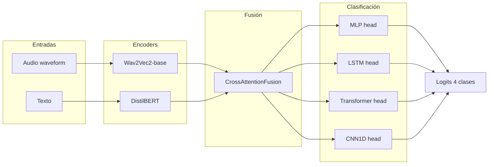

# Experimentos 01-04: Classification Heads

**IDs**: 01, 02, 03, 04  
**Objetivo**: Determinar la mejor cabeza de clasificación sobre características fusionadas (MLP, LSTM, Transformer, CNN1D) en arquitectura bimodal Audio+Texto.

---

## Diagrama de bloques

Flujo simplificado por experimento:
- **01**: CrossAttentionFusion → MLP (por defecto en `ConformerMultimodalModel`).
- **02**: CrossAttentionFusion → LSTMClassificationHead.
- **03**: CrossAttentionFusion → TransformerClassificationHead.
- **04**: CrossAttentionFusion → CNN1DClassificationHead.

*(En el diagrama se muestran las cuatro cabezas; cada experimento usa solo una.)*

---

## Dimensiones

| Elemento | Dimensión |
|----------|-----------|
| Audio entrada | Waveform 8 s, 16 kHz |
| Texto entrada | max_length=128 tokens |
| Wav2Vec2-base salida | (B, T_audio, 768) → pooled 768 |
| DistilBERT salida | (B, 128, 768) → pooled 768 |
| hidden_dim (proyección fusión) | 256 |
| Salida fusión (antes de head) | 256 o 256//2 según implementación |
| num_classes | 4 |

Configuración típica en YAML: `hidden_dim: 256`, `dropout: 0.3`, `fusion_type: cross_attention`.

---

## Paso a paso

1. **Extracción de features**
   - Audio: waveform → Wav2Vec2 → características por frame (768) → pooling temporal.
   - Texto: tokens → DistilBERT → última capa oculta (768) → [CLS] o pooling.

2. **Fusión**
   - `CrossAttentionFusion`: proyección de audio y texto a `hidden_dim`, cross-attention, concatenación o combinación a vector de dimensión común (ej. 256).

3. **Clasificación**
   - **01**: MLP (varias capas lineales + activación + dropout) → logits 4 clases.
   - **02**: LSTM bidireccional sobre secuencia (si hay secuencia) o sobre el vector fusionado expandido → capa lineal → logits.
   - **03**: Transformer encoder sobre secuencia de features → pooling → lineal → logits.
   - **04**: Convoluciones 1D sobre secuencia → pooling → lineal → logits.

---

## Config e hiperparámetros (resumen)

| Parámetro | 01 | 02-04 |
|-----------|-----|--------|
| audio_encoder | facebook/wav2vec2-base | idem |
| text_encoder | distilbert-base-uncased | idem |
| hidden_dim | 256 | 256 |
| dropout | 0.3 | 0.3 |
| classification_head_type | (MLP por defecto) | lstm / transformer / cnn1d |
| batch_size | 2 | 2 |
| num_epochs | 100 | 100 |
| loss | focal (01) | según config |

Configs: `config/ablation/ablation_01_unfreeze_encoders.yaml`, `ablation_02_lstm_head.yaml`, `ablation_03_transformer_head.yaml`, `ablation_04_cnn1d_head.yaml`.

---

## Resultados test

- **01**: Test UA 55.31% (baseline 4 clases). Ver [ANALISIS_RESULTADOS_EXPERIMENTOS.md](../ANALISIS_RESULTADOS_EXPERIMENTOS.md#serie-01-10).
- **02, 03, 04**: N/A en este documento (ejecutar o ver checkpoints).

---

[Trazabilidad: Ablation01Model–04Model en `src/ablation_studies/`, CrossAttentionFusion en `src/models/fusion.py`]
