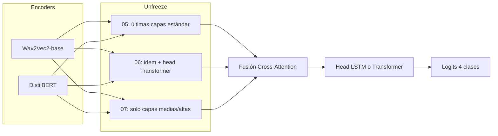

# Experimentos 05-07: Estrategias de Unfreezing

**IDs**: 05, 06, 07  
**Objetivo**: Evaluar qué capas de los encoders pre-entrenados (Wav2Vec2, DistilBERT) descongelar durante el fine-tuning.

---

## Diagrama de bloques

- **05**: Unfreeze estándar (últimas N capas) + cabeza LSTM. Config: `audio_unfreeze_last_n_layers`, `text_unfreeze_last_n_layers`.
- **06**: Misma estrategia de unfreeze + cabeza Transformer.
- **07**: Solo capas medias y altas descongeladas; capas bajas congeladas (análogo a Ablation 13 con ViT).

---

## Dimensiones

Igual que serie 01-04: encoders 768 dim, `hidden_dim: 256`, 4 clases. La diferencia está solo en qué parámetros tienen `requires_grad=True`.

---

## Paso a paso

1. **Extracción**: Igual que 01 (Wav2Vec2 + DistilBERT).
2. **Unfreezing**:
   - 05/06: últimas `audio_unfreeze_last_n_layers` y `text_unfreeze_last_n_layers` con `requires_grad=True`.
   - 07: solo capas medias/altas (p. ej. no las primeras capas) de cada encoder.
3. **Fusión y clasificación**: CrossAttentionFusion + LSTM (05, 07) o Transformer head (06).

---

## Config e hiperparámetros

| Parámetro | 05 | 06 | 07 |
|-----------|-----|-----|-----|
| classification_head_type | lstm | transformer | lstm |
| audio_unfreeze_last_n_layers | (desde YAML) | (desde YAML) | mid/high only |
| text_unfreeze_last_n_layers | (desde YAML) | (desde YAML) | mid/high only |

Configs: `ablation_05_unfreeze_lstm.yaml`, `ablation_06_unfreeze_transformer.yaml`, `ablation_07_unfreeze_mid_high_lstm.yaml`.

---

## Resultados test

N/A en este documento. Ver tabla maestra en [ANALISIS_RESULTADOS_EXPERIMENTOS.md](../ANALISIS_RESULTADOS_EXPERIMENTOS.md).

---

[Trazabilidad: Ablation05Model, Ablation06Model, Ablation07Model en `src/ablation_studies/`]
