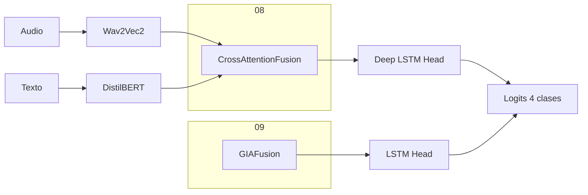

# Experimentos 08-09: Profundidad y fusión inicial

**IDs**: 08, 09  
**Objetivo**: Aumentar capacidad del modelo: LSTM más profundo (08) o introducir Gated Interaction Attention como fusión preliminar (09).

---

## Diagrama de bloques

- **08**: Misma fusión cross-attention que la base; cabeza **LSTM más profunda** (más capas).
- **09**: Sustitución de la fusión por **Gated Interaction Attention (GIAFusion)**; compuertas aprendibles que controlan el flujo entre modalidades antes del head LSTM.

---

## Dimensiones

- Encoders: Wav2Vec2 768, DistilBERT 768.
- hidden_dim: 256 (típico).
- GIAFusion: combina ambas modalidades en dimensión común; salida a LSTM.
- num_classes: 4.

---

## Paso a paso

1. **Extracción**: Audio → Wav2Vec2; Texto → DistilBERT (igual que serie 01-07).
2. **Fusión**:
   - **08**: CrossAttentionFusion (sin cambio respecto a base).
   - **09**: GIAFusion: proyecciones de audio y texto, mecanismo de compuertas (gate) para interacción, salida fusionada.
3. **Clasificación**: LSTM (más capas en 08) → lineal → logits 4 clases.

---

## Config e hiperparámetros

| Parámetro | 08 | 09 |
|-----------|-----|-----|
| fusion_type | cross_attention | GIA (GIAFusion) |
| classification_head_type | lstm | lstm |
| lstm_num_layers | mayor que base | 2 (típico) |

Configs: `config/ablation/ablation_08_deep_lstm.yaml`, `config/ablation/ablation_09_gia_lstm.yaml`.

---

## Resultados test

N/A en este documento. Ver [ANALISIS_RESULTADOS_EXPERIMENTOS.md](../ANALISIS_RESULTADOS_EXPERIMENTOS.md).

---

[Trazabilidad: Ablation08Model, Ablation09Model; GIAFusion en `src/models/fusion.py`]
