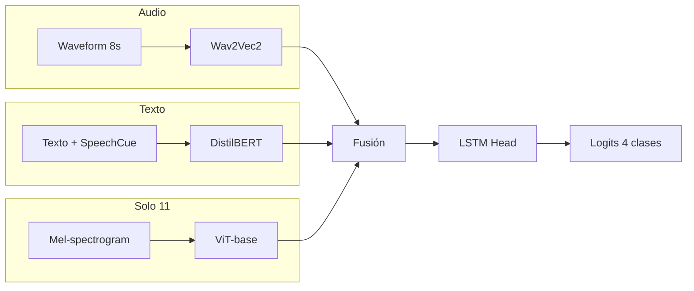

# Experimentos 10-12: SpeechCue y multimodal

**IDs**: 10, 11, 12  
**Objetivo**: Integrar texto enriquecido con prosodia (SpeechCue), rama visual con ViT sobre mel-espectrogramas, y validación LOSO (12).

---

## Diagrama de bloques

- **10**: Bimodal (Audio + Texto). Texto con **SpeechCue** (prompts internos de prosodia inyectados en el pipeline).
- **11**: **Trimodal**: Audio + Texto + **rama visual** (mel-espectrograma como imagen 224×224 → ViT). Fusión trimodal (p. ej. TriModalCrossAttentionFusion).
- **12**: Misma arquitectura que 10; evaluación **Leave-One-Speaker-Out (LOSO)** en lugar de split fijo.

---

## Dimensiones

| Elemento | Dimensión |
|----------|-----------|
| Audio | 768 (Wav2Vec2 pooled) |
| Texto | 768 (DistilBERT), max_length=128 |
| Mel (visual) | 80 mel bins × T → imagen 224×224 para ViT |
| ViT salida | 768 |
| hidden_dim | 256 |
| num_classes | 4 |

---

## Paso a paso

1. **Extracción**
   - Audio: waveform → Wav2Vec2 → features 768.
   - Texto: transcripción + **SpeechCue** (marcado prosódico en el texto) → DistilBERT → 768.
   - Visual (11): waveform → mel 80×T → resize/transform a 224×224 → ViT → 768.

2. **Fusión**
   - 10: CrossAttentionFusion (bimodal).
   - 11: TriModalCrossAttentionFusion (audio + texto + visión).

3. **Clasificación**: LSTM head → logits 4 clases.

4. **12**: Mismo modelo que 10; los folds de entrenamiento/validación/test cambian por sesión (LOSO).

---

## Config e hiperparámetros

| Parámetro | 10 | 11 | 12 |
|-----------|-----|-----|-----|
| use_prosody_cues | true | (false en 11, true en 13) | true |
| vision_encoder | - | google/vit-base-patch16-224 | - |
| Evaluación | split fijo | split fijo | LOSO |

Configs: `ablation_10_speechcue_internal.yaml`, `ablation_11_melspec_vit.yaml`, `ablation_12_speechcue_loso.yaml`.

---

## Resultados test

- **12 LOSO**: Test UA por fold 69.60%, 78.52% (parcial). Ver [ANALISIS_RESULTADOS_EXPERIMENTOS.md](../ANALISIS_RESULTADOS_EXPERIMENTOS.md#ablation-12-loso).
- **10, 11**: N/A en este documento.

---

[Trazabilidad: Ablation10Model (hereda Ablation07Model), Ablation11Model; 12 usa Ablation10Model con loop LOSO en `scripts/run_ablation.py`]
