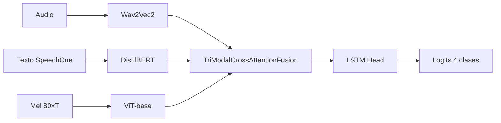

# Experimento 13 y variantes (13a-13f, 20): Baseline trimodal y regularización

**IDs**: 13, 14-20  
**Objetivo**: Establecer un baseline trimodal robusto (Audio + Texto con SpeechCue + ViT) y probar regularización, ViT congelado, Focal Loss y K-Fold.

---

## Diagrama de bloques

| ID | Variante | Diferencia principal |
|----|----------|----------------------|
| 13 | Trimodal ViT + SpeechCue | ViT parcialmente unfreeze (últimas N capas), SpeechCue, cross_attention |
| 14 (13a) | Regularized | + dropout, weight decay |
| 15 (13b) | No SpeechCue | Sin prosodia en texto |
| 16 (13c) | Frozen ViT | ViT totalmente congelado (base para 21-28) |
| 17 (13d) | High reg | Regularización agresiva |
| 18 (13e) | Advanced reg | Label smoothing, Mixup |
| 19 (13f) | Focal Loss | Focal loss en lugar de cross-entropy |
| 20 | 13d K-Fold | Mismo que 13d, evaluación K-Fold 5 folds |

---

## Dimensiones

- Wav2Vec2: 768. DistilBERT: 768. ViT: 768.
- hidden_dim: 256 (13 típico).
- fusion_num_heads: 4.
- LSTM: 2 capas, bidireccional; salida a lineal 4 clases.

---

## Paso a paso

1. **Extracción**: Audio → Wav2Vec2; Texto (con SpeechCue si está activo) → DistilBERT; Mel → ViT (congelado o parcialmente unfreeze según variante).
2. **Fusión**: TriModalCrossAttentionFusion (audio, texto, visión) → vector fusionado.
3. **Clasificación**: LSTM head → logits 4 clases.
4. **Loss**: cross_entropy (13, 13a-13e, 20) o focal (13f).

---

## Config e hiperparámetros (resumen)

| Parámetro | 13 | 13c (16) |
|-----------|-----|-----------|
| fusion_type | cross_attention | cross_attention |
| vision_unfreeze_last_n_layers | 6 | 0 |
| freeze_vision_encoder | true | true |
| batch_size | 2 | 2 |
| num_epochs | 100 | 100 |

Configs: `ablation_13_melspec_vit_speechcue_unfreeze_vit.yaml`, `ablation_13a_regularized.yaml`, …, `ablation_13f_focal_loss.yaml`, `ablation_13d_kfold.yaml`.

---

## Resultados test

- **13**: Test UA **74.46%**, F1 macro 74.18%, Gap 7.59%. Ver [ANALISIS_RESULTADOS_EXPERIMENTOS.md](../ANALISIS_RESULTADOS_EXPERIMENTOS.md#serie-11-13).
- **20 (25 K-Fold)** en documento se refiere a study 29 (ablation_25_kfold); para 13d K-Fold ver tabla maestra.
- Resto: N/A en este documento.

---

[Trazabilidad: Ablation13Model (hereda Ablation11Model), configs 13/13a-13f/13d_kfold en `config/ablation/`]
