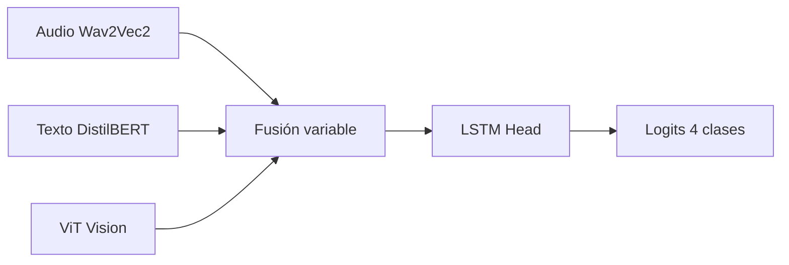

# Experimentos 21-28: Mecanismos de fusión avanzados

**IDs**: 21, 22, 23, 24, 25, 26, 27, 28  
**Objetivo**: Comparar distintos mecanismos de fusión trimodal manteniendo base 13c (ViT congelado + SpeechCue); solo cambia el módulo de fusión.

---

## Diagrama de bloques (común)

| ID | Nombre | Clase de fusión (src/models/fusion.py) |
|----|--------|----------------------------------------|
| 21 | Hierarchical | TriModalHierarchicalFusion (Audio+Texto → luego + Visión) |
| 22 | Tensor Fusion | TriModalTensorFusion (producto exterior modalidades) |
| 23 | Bilinear | TriModalBilinearFusion (bilinear pooling) |
| 24 | Adaptive Weighted | TriModalAdaptiveWeightedFusion (pesos aprendidos por modalidad) |
| 25 | Enhanced Cross-Attention | TriModalEnhancedCrossAttentionFusion (varias capas cross-attention) |
| 26 | Gated Fusion | TriModalGatedFusion (GMU) |
| 27 | Late Fusion | TriModalLateFusion (logits/prob concatenados o promediados) |
| 28 | GLU Fusion | TriModalGLUFusion (Gated Linear Units) |

---

## Dimensiones

- Encoders: 768 cada uno (Wav2Vec2, DistilBERT, ViT).
- hidden_dim: 256 (típico); 25 usa fusion_num_heads: 4, fusion_num_layers: 3.
- Salida fusión → LSTM 2 capas bidireccional → 4 clases.

---

## Paso a paso

1. **Extracción**: Igual que 13 (Audio, Texto SpeechCue, Mel→ViT congelado).
2. **Fusión**:
   - **21**: Primero fusiona audio+texto; el resultado se fusiona con visión.
   - **22**: Tensor fusion (todas las interacciones entre modalidades; coste computacional alto).
   - **23**: Bilinear pooling (interacciones de segundo orden).
   - **24**: Pesos escalares (sigmoide) por modalidad, combinación ponderada.
   - **25**: Múltiples capas de cross-attention entre las tres modalidades (hidden_dim, num_heads, num_layers).
   - **26**: Gated Multimodal Unit (compuertas que controlan flujo por modalidad).
   - **27**: Cada modalidad pasa por su propio clasificador; se promedian o concatenan logits.
   - **28**: GLU para fusión no lineal.
3. **Clasificación**: LSTM head común → logits 4 clases.

---

## Config e hiperparámetros (resumen)

| Parámetro | 21 | 25 | 28 |
|-----------|-----|-----|-----|
| fusion_type | hierarchical | enhanced_cross_attention | glu_fusion |
| fusion_num_heads | 4 | 4 | - |
| fusion_num_layers | - | 3 | - |
| hidden_dim | 256 | 256 | 256 |
| dropout | 0.4 | 0.4 | 0.4 |

Configs: `ablation_21_hierarchical_fusion.yaml` … `ablation_28_glu_fusion.yaml`.

---

## Resultados test

- **21**: Test UA **74.64%**, Gap ~6.9%.
- **25**: Test UA **77.44%**, F1 77.09%, Gap 4.86% (mejor fusión; base para 31-35).
- **28**: Test UA **74.27%**, Gap ~7.4%.
- 22, 23, 24, 26, 27: N/A en este documento.

Ver [ANALISIS_RESULTADOS_EXPERIMENTOS.md](../ANALISIS_RESULTADOS_EXPERIMENTOS.md#serie-21-28).

---

[Trazabilidad: Ablation21Model–Ablation28Model; clases de fusión en `src/models/fusion.py`]
