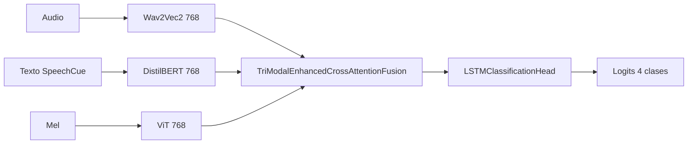

# Experimento 25: Enhanced Cross-Attention

**ID**: 25 (y 29 como K-Fold)  
**Objetivo**: Fusión trimodal con múltiples capas de cross-attention (TriModalEnhancedCrossAttentionFusion) para modelar mejor las interacciones entre Audio, Texto y Visión. Base para experimentos 31-35.

---

## Diagrama de bloques

---

## Dimensiones

| Elemento | Dimensión |
|----------|-----------|
| audio_dim (Wav2Vec2) | 768 |
| text_dim (DistilBERT) | 768 |
| vision_dim (ViT) | 768 |
| hidden_dim | 256 |
| fusion_num_heads | 4 |
| fusion_num_layers | 3 |
| Salida fusión (antes del classifier interno) | hidden_dim // 2 = 128 (entrada al LSTM head) |
| num_classes | 4 |

El módulo `TriModalEnhancedCrossAttentionFusion` proyecta las tres modalidades a `hidden_dim`, aplica `num_layers` capas de cross-attention (cada modalidad atiende a las otras), y expone un `classifier` que aquí es `LSTMClassificationHead`: LSTM 2 capas bidireccional sobre la secuencia fusionada, luego lineal a 4 clases.

---

## Paso a paso

1. **Extracción de features**
   - Audio: waveform → Wav2Vec2 → (B, T_audio, 768) → pooling o uso de secuencia.
   - Texto: tokens con SpeechCue → DistilBERT → (B, 128, 768).
   - Visión: mel-espectrograma 224×224 → ViT (congelado) → (B, 768) o secuencia.

2. **Fusión (Enhanced Cross-Attention)**
   - Proyección lineal de audio, texto y visión a `hidden_dim` (256).
   - Varias capas (3) de cross-attention: cada modalidad como query atiende a las otras como key/value; residual y normalización.
   - Salida concatenada o promediada a dimensión fija (ej. hidden_dim//2) y pasada al classifier.

3. **Clasificación**
   - LSTMClassificationHead: LSTM(128, 2 capas, bidireccional) → pooling → dropout → lineal(→ 4).

---

## Config e hiperparámetros

- `fusion_type: "enhanced_cross_attention"`
- `fusion_num_heads: 4`, `fusion_num_layers: 3`
- `hidden_dim: 256`, `dropout: 0.4`
- `classification_head_type: "lstm"`, `lstm_num_layers: 2`, `lstm_bidirectional: true`
- `vision_encoder: "google/vit-base-patch16-224"`, `freeze_vision_encoder: true`
- `batch_size: 2`, `num_epochs: 100`, `learning_rate_fusion: 5.0e-6`

Config: `config/ablation/ablation_25_enhanced_cross_attention.yaml`. K-Fold: `ablation_25_kfold.yaml` (study 29).

---

## Resultados test

- **25**: Test UA **77.44%**, F1 macro 77.09%, Gap 4.86%. Mejor fusión base.
- **29 (25 K-Fold)**: Promedio Test UA **75.71%** (Std 4.19%), F1 74.87%.

Ver [ANALISIS_RESULTADOS_EXPERIMENTOS.md](../ANALISIS_RESULTADOS_EXPERIMENTOS.md#serie-21-28) y [Ablation 25 K-Fold](../ANALISIS_RESULTADOS_EXPERIMENTOS.md#ablation-25-k-fold-5-folds).

---

[Trazabilidad: Ablation25Model en `src/ablation_studies/ablation_25_enhanced_cross_attention.py`, TriModalEnhancedCrossAttentionFusion en `src/models/fusion.py`]
