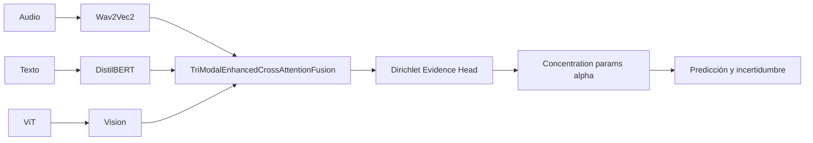

# Experimento 30: Dirichlet Evidence Learning

**ID**: 30  
**Objetivo**: Sustituir la salida softmax por un modelo de evidencia Dirichlet para capturar incertidumbre epistémica y mejorar la calibración de confianza. Arquitectura de fusión igual que Ablation 25 (Enhanced Cross-Attention); solo cambia la cabeza de clasificación y la loss.

---

## Diagrama de bloques

---

## Dimensiones

- Mismas que Ablation 25: encoders 768, hidden_dim 512 (en config 30), fusion_num_heads 8, fusion_num_layers 3.
- Cabeza Dirichlet: la salida del fusion se mapea a parámetros de concentración alpha (K valores por clase); la loss es Dirichlet (evidencia) en lugar de cross-entropy.

---

## Paso a paso

1. **Extracción y fusión**: Igual que 25 (Wav2Vec2 + DistilBERT + ViT → TriModalEnhancedCrossAttentionFusion).
2. **Clasificación Dirichlet**: En lugar de logits → softmax, el modelo produce parámetros alpha > 0; la predicción se obtiene de la distribución Dirichlet (p. ej. mean o modo); la loss penaliza evidencia incorrecta y favorece alta evidencia en la clase correcta.
3. **Loss**: `type: "dirichlet"` en config; no usar label_smoothing típico de CE.

---

## Config e hiperparámetros

- Base: igual que 25 (enhanced_cross_attention, 3 layers).
- `hidden_dim: 512`, `fusion_num_heads: 8`
- `loss.type: "dirichlet"`
- `batch_size: 4`, `gradient_accumulation_steps: 16`

Config: `config/ablation/ablation_30_dirichlet.yaml`.

---

## Resultados test

- Test UA **75.24%**, F1 macro 75.06%. Validación UA **85.02%** (mejor val de todos los experimentos); Gap val-test **9.78%** (posible overfitting). Buen rendimiento en Angry; Neutral con F1 bajo (56.56%).

Ver [ANALISIS_RESULTADOS_EXPERIMENTOS.md](../ANALISIS_RESULTADOS_EXPERIMENTOS.md#ablation-30-dirichlet-fusion).

---

[Trazabilidad: Ablation30Model en `src/ablation_studies/ablation_30_dirichlet.py`, hereda Ablation25Model]
