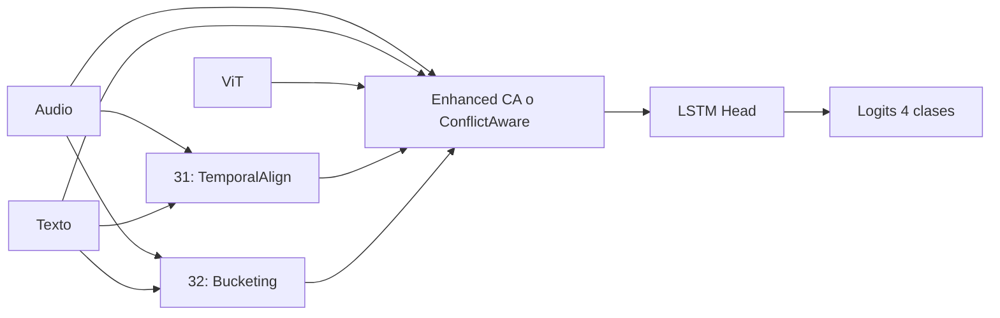

# Experimentos 31-35: Innovaciones multimodales avanzadas

**IDs**: 31, 32, 33, 34, 35  
**Objetivo**: Probar mejoras sobre la base Ablation 25 (Enhanced Cross-Attention): alineación temporal, bucketing, SpeechCue consciente de ruido, fusión conflict-aware y active learning estratificado por modalidad.

---

## Diagrama de bloques (común base 25)

| ID | Nombre | Innovación |
|----|--------|------------|
| 31 | Temporal Alignment | Módulo de alineación temporal (DTW adaptivo) antes de la fusión; audio y texto se "estiran/comprimen" para alinear eventos. |
| 32 | Temporal Bucketing | División en ventanas ~400 ms; fusión por bucket; LSTM sobre secuencia de buckets. |
| 33 | Noise-Aware SpeechCue | Detección de ruido en audio; si hay ruido, se inyecta token [UNCERTAIN] en el texto para que BERT desconfíe de la prosodia. |
| 34 | Conflict-Aware Cross-Attention | Detección de contradicciones entre modalidades (ej. texto feliz + audio enojado); ponderación por confianza o resolución adaptativa. Ver [34_conflict_aware.md](34_conflict_aware.md). |
| 35 | Modal-Stratified Active Learning | Estrategia de entrenamiento: el modelo identifica la modalidad más confusa y puede solicitar etiquetas adicionales para esa modalidad. |

---

## Dimensiones

- Encoders y hidden_dim como en 25 (768, 256). 34 puede usar conflict_aware con mismo hidden_dim y fusion_num_layers: 3.
- 31: salida del módulo de alineación mantiene dimensiones de entrada (768 cada una) antes de entrar a fusión.
- 32: cada bucket produce un vector fusionado; secuencia de buckets → LSTM.

---

## Paso a paso

1. **31 (Temporal Alignment)**: Audio y texto pasan por módulo de alineación temporal (DTW aprendido o fijo); las secuencias alineadas se envían a TriModalEnhancedCrossAttentionFusion.
2. **32 (Temporal Bucketing)**: Audio y texto se segmentan en ventanas temporales; dentro de cada ventana se fusionan; la secuencia de vectores fusionados pasa por LSTM.
3. **33 (Noise-Aware SpeechCue)**: El pipeline de texto recibe una señal de "ruidoso"; si es true, se añade [UNCERTAIN]. Resto igual que 25.
4. **34 (Conflict-Aware)**: Fusión reemplazada por ConflictAwareCrossAttentionFusion: se obtienen logits por modalidad, se detectan conflictos (prediction_divergence / feature_distance / learned), se pondera la fusión por confianza. Ver doc dedicado.
5. **35 (Modal-Stratified AL)**: Misma arquitectura que 25; el training loop implementa estrategia de active learning por modalidad (no solo cambio de arquitectura).

---

## Config e hiperparámetros (resumen)

| Parámetro | 31 | 32 | 33 | 34 | 35 |
|-----------|-----|-----|-----|-----|-----|
| fusion_type | enhanced_cross_attention | enhanced + bucketing | enhanced_cross_attention | conflict_aware_cross_attention | enhanced_cross_attention |
| conflict_aware | - | - | - | enabled | - |

Configs: `ablation_31_temporal_alignment.yaml`, `ablation_32_temporal_bucketing.yaml`, `ablation_33_noise_aware_speechcue.yaml`, `ablation_34_conflict_aware_attention.yaml`, `ablation_35_modal_stratified_al.yaml`.

---

## Resultados test

| ID | Test UA | F1 macro | Gap |
|----|---------|----------|-----|
| 31 | 73.36% | 73.28% | ~8.4% |
| 32 | 73.26%-73.80% | 78.40% | ~7.9% |
| 33 | 72.96% | 72.98% | ~6.5% |
| **34** | **77.98%** | **77.59%** | **2.68%** |
| 35 | 74.05% | 73.74% | 6.32% |

34 es el mejor en test y en generalización. Ver [ANALISIS_RESULTADOS_EXPERIMENTOS.md](../ANALISIS_RESULTADOS_EXPERIMENTOS.md#serie-30-35).

---

[Trazabilidad: Ablation31Model–Ablation35Model en `src/ablation_studies/`; ConflictAwareCrossAttentionFusion en `src/models/fusion.py`]
