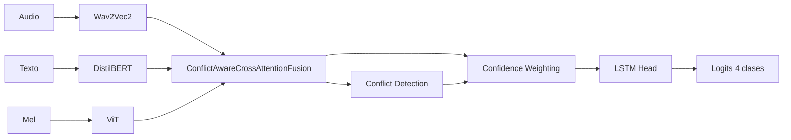
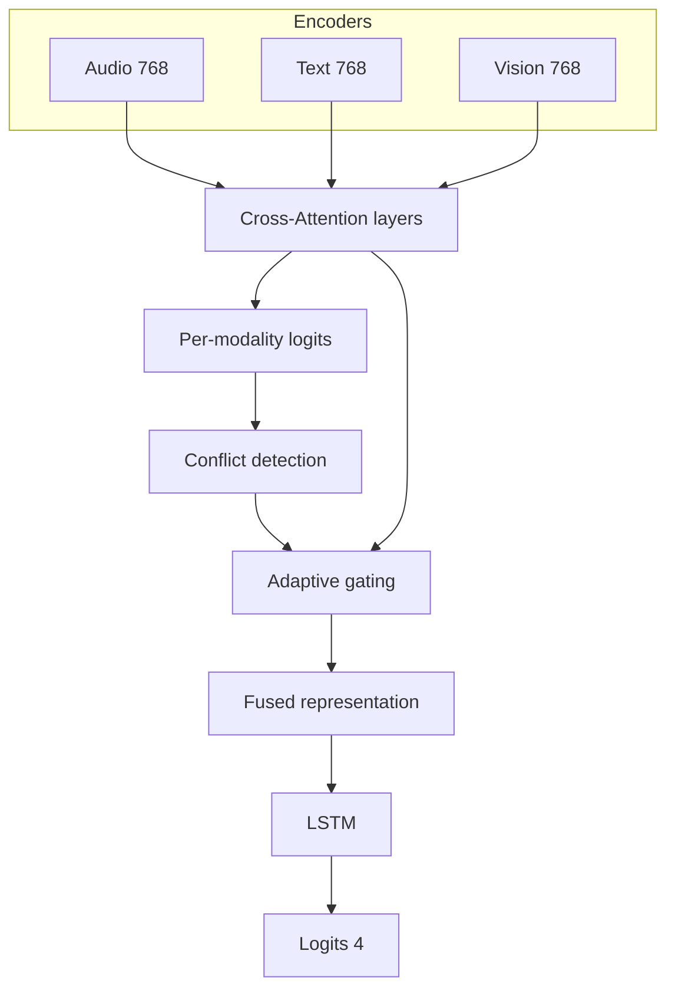

# Experimento 34: Conflict-Aware Cross-Attention

**ID**: 34  
**Objetivo**: Detectar contradicciones entre modalidades (ej. texto feliz vs audio enojado) y ponderar la fusión por confianza o resolver el conflicto de forma adaptativa, mejorando la generalización (menor gap val-test).

---

## Diagrama de bloques

### Vista Mermaid (flujo lateral)



### Vista Mermaid (flujo vertical)



### Diagramas en formato texto (bloques y conexiones)

**Flujo de alto nivel (entradas → encoders → fusión → salida):**

```
┌─────────────────────────────────────────────────────────────────────────────────────────┐
│ ENTRADAS                                                                                │
├──────────────┬──────────────────────┬─────────────────────────────────────────────────┤
│ Audio        │ Texto                 │ Visión                                           │
│ waveform     │ tokens (SpeechCue)    │ mel-spectrogram → imagen 224×224                 │
│ 8s @ 16 kHz  │ max_length=128        │ (80×T mel → resize/reshape)                      │
└──────┬───────┴──────────┬────────────┴────────────────┬────────────────────────────────┘
       │                  │                               │
       ▼                  ▼                               ▼
┌──────────────┐  ┌──────────────┐              ┌──────────────┐
│ Wav2Vec2     │  │ DistilBERT   │              │ ViT-base     │
│ (audio_enc)  │  │ (text_enc)   │              │ patch16-224  │
│ out: (B,T,768)│  │ out: (B,768) │              │ out: (B,768)  │
└──────┬───────┘  └──────┬───────┘              └──────┬───────┘
       │                  │                               │
       └──────────────────┼───────────────────────────────┘
                           │
                           ▼
┌─────────────────────────────────────────────────────────────────────────────────────────┐
│ ConflictAwareCrossAttentionFusion                                                        │
│ • Cross-Attention (num_heads=8, num_layers=3) entre Audio, Texto, Visión                  │
│ • Logits por modalidad → Conflict Detection (prediction_divergence / feature_distance /  │
│   learned)                                                                               │
│ • Confidence weighting / conflict_resolution → representación fusionada (B,T,hidden_dim)  │
└─────────────────────────────────────────────┬───────────────────────────────────────────┘
                                              │
                                              ▼
┌─────────────────────────────────────────────────────────────────────────────────────────┐
│ LSTM Head (2 capas, bidireccional)                                                       │
│ (B, T, hidden_dim) → (B, 4)                                                             │
└─────────────────────────────────────────────┬───────────────────────────────────────────┘
                                              │
                                              ▼
                                    ┌─────────────────┐
                                    │ Logits 4 clases │
                                    │ (angry, happy,  │
                                    │  sad, neutral)   │
                                    └─────────────────┘
```

**Bloques y dimensiones (config mejor run 20251210_191151):**

```
                    DIMENSIONES POR BLOQUE

  [Audio]           [Texto]            [Visión]
  (B,128000)        (B,128)           (B,80,T_mel) → (B,3,224,224)
      │                  │                    │
      ▼                  ▼                    ▼
  Wav2Vec2          DistilBERT           ViT-base
  (B,T_a,768)       (B,768)              (B,768)
      │                  │                    │
      └────────────┬──────┴────────────────────┘
                   │
                   ▼
  ┌────────────────────────────────────────────────┐
  │ Proyección a hidden_dim=512 (si 768≠512)       │
  └────────────────────┬─────────────────────────┘
                   │
                   ▼
  ┌────────────────────────────────────────────────┐
  │ Cross-Attention × 3 layers, 8 heads             │
  │ • Q,K,V por modalidad → atención cruzada        │
  │ • Salida: (B, T, 512)                           │
  └────────────────────┬─────────────────────────┘
                   │
         ┌─────────┴─────────┐
         ▼                   ▼
  ┌──────────────┐   ┌──────────────────────────┐
  │ Per-modality │   │ Conflict Detection       │
  │ logits (B,4) │   │ (método configurable)    │
  │ ×3           │   │ → máscara/ponderación   │
  └──────┬───────┘   └────────────┬─────────────┘
         │                        │
         └────────────┬───────────┘
                      ▼
  ┌────────────────────────────────────────────────┐
  │ Confidence weighting / conflict resolution      │
  │ Fused (B, T, 512)                              │
  └────────────────────┬─────────────────────────┘
                       │
                       ▼
  ┌────────────────────────────────────────────────┐
  │ LSTM 2 capas, bidireccional, dropout 0.5        │
  │ (B, T, 512) → (B, 512*2) → proy → (B, 4)       │
  └────────────────────┬─────────────────────────┘
                       │
                       ▼
                 Logits (B, 4)
```

**Conexiones entre módulos (resumen):**

| Origen | Destino | Descripción |
|--------|---------|-------------|
| Audio waveform | Wav2Vec2 | Raw audio → features (B, T_a, 768) |
| Texto tokens | DistilBERT | Input IDs → pooled (B, 768) |
| Mel como imagen | ViT | Patches 16×16 → (B, 768) |
| Wav2Vec2 out | ConflictAwareFusion | Como query/key/value en cross-attention |
| DistilBERT out | ConflictAwareFusion | Expandido/repetido en tiempo si hace falta |
| ViT out | ConflictAwareFusion | Idem |
| Cross-attention out | Conflict detection | Logits por modalidad para prediction_divergence |
| Cross-attention out | Confidence gate | Ponderación por confianza |
| Fused repr | LSTM | Secuencia (B, T, 512) |
| LSTM out | Clasificador lineal | → Logits (B, 4) |

---

## Dimensiones

(Config del mejor run: `ablation_34_20251210_191151`.)

- **Audio**: 768 (Wav2Vec2-base). **Texto**: 768 (DistilBERT). **Visión**: 768 (ViT-base-patch16-224).
- **hidden_dim**: 512. **fusion_num_heads**: 8. **fusion_num_layers**: 3.
- Conflict detection: según método (prediction_divergence usa logits por modalidad; feature_distance usa embeddings; learned usa MLP sobre concatenación).
- **Salida**: LSTM 2 capas bidireccional → proyección lineal → 4 clases.

---

## Paso a paso

1. **Extracción**: Igual que 25 (Wav2Vec2 + DistilBERT + ViT).
2. **Cross-attention**: Varias capas de cross-attention entre las tres modalidades (como 25).
3. **Detección de conflicto** (config: `model.conflict_aware.conflict_detection_method`):
   - **prediction_divergence**: Se obtienen logits por modalidad; si dos o más predicen distinta clase → conflicto.
   - **feature_distance**: Distancia coseno media entre embeddings; si > `conflict_threshold` → conflicto.
   - **learned**: MLP sobre concatenación de embeddings → probabilidad de conflicto; si > threshold → conflicto.
4. **Ponderación por confianza**: Si hay conflicto, se reduce el peso de modalidades menos confiables o se aplica resolución (ej. confidence_weighted, adaptive_gated_weighted).
5. **Clasificación**: Representación fusionada ponderada → LSTM head → logits 4 clases.

---

## Config e hiperparámetros

- `fusion_type: "conflict_aware_cross_attention"` (o en variante trimodal con Wav2Vec2: ver run_ablation study 34).
- `conflict_aware.enabled: true`
- `conflict_aware.conflict_detection_method: "prediction_divergence"` | `"feature_distance"` | `"learned"`
- `conflict_aware.conflict_threshold: 0.25`–0.3
- `conflict_aware.confidence_weighting: true`
- `conflict_aware.conflict_resolution: "confidence_weighted"` | `"adaptive_gated_weighted"`

Config: `config/ablation/ablation_34_conflict_aware_attention.yaml`. Métodos de detección: [CONFLICT_DETECTION.md](../CONFLICT_DETECTION.md).

---

## Resultados test

- **Mejor ejecución (20251210_191151)**: Test UA **77.98%**, F1 macro 77.59%, Gap **2.68%** (mejor generalización).
- Otras ejecuciones: Test UA entre 71.85% y 77.98%; variabilidad notable.
- Por clase (mejor run): Angry 85.61% acc / 85.00% F1; Neutral 72.16% acc / 62.50% F1.

Ver [ANALISIS_RESULTADOS_EXPERIMENTOS.md](../ANALISIS_RESULTADOS_EXPERIMENTOS.md#ablation-34-conflict-aware-cross-attention).

---

[Trazabilidad: Ablation34Model en `src/ablation_studies/ablation_34_model.py`; ConflictAwareCrossAttentionFusion en `src/models/fusion.py`]
