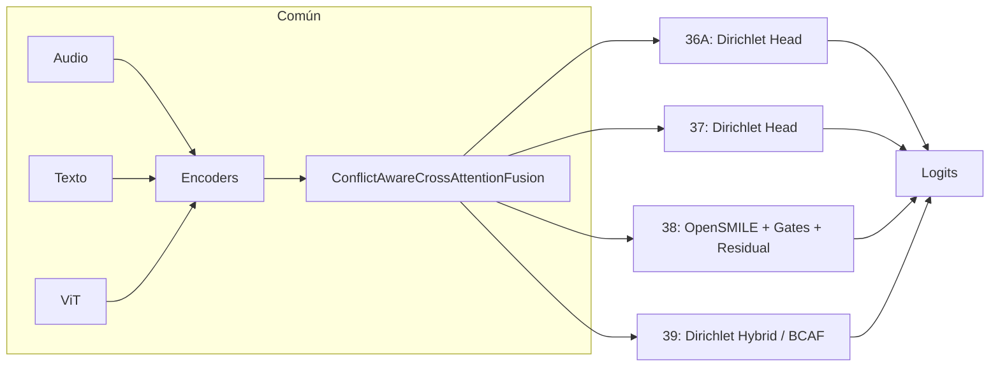

# Experimentos 36-39: Conflict-Aware + Dirichlet y SOTA

**IDs**: 36 (36A), 37, 38, 39 (36C)  
**Objetivo**: Combinar Conflict-Aware (base 34) con Dirichlet (30), Focal Loss, OpenSMILE, o mejoras SOTA (ACN, MIC, BCAF). Study 38 en run_ablation = Ablation 38 (OpenSMILE); 39 = 36C.

---

## Diagrama de bloques (por experimento)

| Study | Ablation | Descripción |
|-------|----------|-------------|
| 36 | 36A | Conflict-Aware + cabeza **Dirichlet** (pure). Loss dirichlet, dropout 0.5, weight_decay 0.1. |
| 37 | 37 | Dirichlet + Conflict-Aware (config específica que combina ambos). |
| 38 | 38 | **OpenSMILE** (eGeMAPSv02, 88 features) + attention gates + cross-attention Wav2Vec2↔OpenSMILE + conexiones residuales. Conflict-Aware se mantiene. |
| 39 | 36C | Conflict-Aware + **Dirichlet hybrid** (regularización adicional para neutral) o modelo SOTA (ACN+MIC+BCAF según config). |

---

## Dimensiones

- **36A, 37**: Como 34 (hidden_dim 256, 3 layers) + cabeza Dirichlet en lugar de LSTM→lineal.
- **38**: hidden_dim 384; rama OpenSMILE 88 dim; fusión audio con residual_alpha; attention_gates; resto igual que 34.
- **39**: Como 34 o 36C; si BCAF: BidirectionalConnectionAttentionFusion + posible ACN (Audio Context Network) y MIC (Modal Invariance Constraint).

---

## Paso a paso

1. **36A / 37**: Misma fusión Conflict-Aware que 34; el classifier es reemplazado por cabeza Dirichlet (salida = parámetros alpha); loss = Dirichlet evidence loss.
2. **38**: Audio pasa además por extractor OpenSMILE → 88 features; estas se fusionan con Wav2Vec2 mediante cross-attention y residual; attention gates filtran características; el resultado se combina con texto y visión en ConflictAwareCrossAttentionFusion.
3. **39**: Si 36C: Conflict-Aware + Dirichlet con regularización extra para neutral. Si SOTA: ACN sobre audio, MIC (invariante por modalidad), BCAF (Bidirectional Connection Attention Fusion) con autoencoder.

---

## Config e hiperparámetros (resumen)

| Parámetro | 36A | 37 | 38 | 39 |
|-----------|-----|-----|-----|-----|
| fusion_type | conflict_aware_cross_attention | idem | idem + opensmile | idem / BCAF |
| loss.type | dirichlet | dirichlet | cross_entropy | dirichlet hybrid / - |
| opensmile | - | - | eGeMAPSv02, 88 dim | - |
| hidden_dim | 256 | 256 | 384 | 256 |

Configs: `ablation_36a_dirichlet_conflict.yaml`, `ablation_37_dirichlet_conflict_aware.yaml`, `ablation_38_opensmile_residual.yaml`, `ablation_36c_hybrid_conflict.yaml` (study 39).

---

## Resultados test

N/A en este documento (ejecutar o ver checkpoints). Ver tabla maestra y [ANALISIS_RESULTADOS_EXPERIMENTOS.md](../ANALISIS_RESULTADOS_EXPERIMENTOS.md#serie-36-39).

---

[Trazabilidad: Ablation36AModel, Ablation38Model, Ablation36CModel/Ablation39Model en `src/ablation_studies/`; OpenSMILE y BCAF en `src/models/`]
