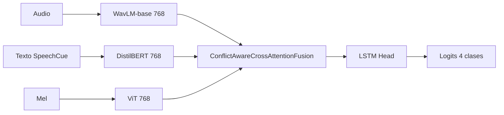

# Experimento 40: WavLM-base + Conflict-Aware (Trimodal)

**ID**: 40  
**Objetivo**: Evaluar si el encoder de audio **WavLM-base** (en lugar de Wav2Vec2-base) mejora el rendimiento con la misma arquitectura trimodal Conflict-Aware que Ablation 34 (ViT + DistilBERT + fusión conflict-aware + LSTM head).

---

## Diagrama de bloques

---

## Dimensiones

- **Audio**: microsoft/wavlm-base → 768 (misma dimensión que Wav2Vec2-base).
- Texto: DistilBERT 768. Visión: ViT 768.
- hidden_dim: 512 (config 40). fusion_num_heads: 8, fusion_num_layers: 3.
- conflict_aware: enabled; conflict_detection_method: prediction_divergence; conflict_threshold: 0.3.
- num_classes: 4.

---

## Paso a paso

1. **Extracción**: Audio → **WavLM-base** (en lugar de Wav2Vec2); texto → DistilBERT con SpeechCue; mel → ViT (congelado o unfreeze según config).
2. **Fusión**: ConflictAwareCrossAttentionFusion (igual que 34): cross-attention + detección de conflicto + ponderación por confianza.
3. **Clasificación**: LSTM head (2 capas, bidireccional) → logits 4 clases.

---

## Config e hiperparámetros

- `audio_encoder: "microsoft/wavlm-base"`
- `text_encoder: "distilbert-base-uncased"`
- `vision_encoder: "google/vit-base-patch16-224"`
- `fusion_type: "conflict_aware_cross_attention"`
- `hidden_dim: 512`, `dropout: 0.5`
- `fusion_num_heads: 8`, `fusion_num_layers: 3`
- `conflict_aware.enabled: true`, `conflict_detection_method: "prediction_divergence"`
- `freeze_text_encoder: true` (config 40); `vision_unfreeze_last_n_layers: 4`
- batch_size: 4, num_epochs: 100

Config: `config/ablation/ablation_40_wavlm_conflict_aware.yaml`.

---

## Resultados test

N/A en este documento (ejecutar experimento). Referencia: Ablation 34 (Wav2Vec2) mejor ejecución 77.98% UA; 40 permite comparar si WavLM aporta mejora (mejor modelado de ruido/speaker).

Ver tabla maestra en [ANALISIS_RESULTADOS_EXPERIMENTOS.md](../ANALISIS_RESULTADOS_EXPERIMENTOS.md).

---

[Trazabilidad: Study 40 usa Ablation34Model con config que carga WavLM; `create_ablation_model(40, ...)` en `scripts/run_ablation.py`; config `ablation_40_wavlm_conflict_aware.yaml`]
