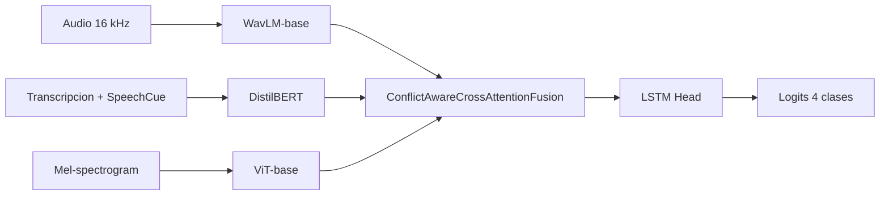

# Experimentos 41-42: WavLM-base + ViT + Conflict-Aware

**IDs**: 41, 42  
**Familia**: WavLM-base + DistilBERT/SpeechCue + ViT + Conflict-Aware Cross-Attention  
**Objetivo general**: comprobar si WavLM-base mejora la rama de audio dentro de la arquitectura trimodal Conflict-Aware, manteniendo visión con ViT y texto con SpeechCue.

---

## Diagrama de bloques



---

## Ablation 41: WavLM-base + ViT + Conflict-Aware, K-Fold

**Config**: `config/ablation/ablation_41_wavlm_base_vit_kfold.yaml`  
**Modelo**: `Ablation34Model`  
**Ejecución**:

```powershell
python scripts\run_ablation.py --study 41 --device cuda
```

### Hipótesis

WavLM-base debería aportar representaciones de audio más robustas al ruido y al hablante que Wav2Vec2-base. Al evaluarlo con K-Fold sobre las sesiones de IEMOCAP, se busca medir estabilidad entre splits y no solo rendimiento en un split fijo.

### Cambios principales

- Cambia el encoder de audio a `microsoft/wavlm-base`.
- Mantiene texto `distilbert-base-uncased` con `use_prosody_cues: true`.
- Mantiene rama visual `google/vit-base-patch16-224`.
- Usa `fusion_type: conflict_aware_cross_attention`.
- Usa `conflict_detection_method: learned`.
- Usa validación cruzada sobre `all_sessions: [1, 2, 3, 4, 5]`.

### Hiperparámetros destacados

| Parámetro | Valor |
|-----------|-------|
| `hidden_dim` | 512 |
| `dropout` | 0.5 |
| `classification_head_type` | `lstm` |
| `fusion_num_heads` | 8 |
| `fusion_num_layers` | 3 |
| `batch_size` | 4 |
| `gradient_accumulation_steps` | 8 |
| `learning_rate_audio` | `3.0e-7` |
| `learning_rate_text` | `1.5e-6` |
| `learning_rate_fusion` | `5.0e-6` |
| `scheduler_type` | `plateau` |
| `scheduler_metric` | `val_loss` |

### Interpretación esperada

Este estudio no solo compara accuracy, sino la estabilidad del modelo entre sesiones. Si el rendimiento medio y la desviación estándar mejoran respecto a variantes previas, WavLM-base estaría aportando generalización speaker-independent.

---

## Ablation 42: WavLM-base + ViT + Conflict-Aware, single split

**Config**: `config/ablation/ablation_42_wavlm_base_vit.yaml`  
**Modelo**: `Ablation34Model`  
**Ejecución**:

```powershell
python scripts\run_ablation.py --study 42 --device cuda
```

### Hipótesis

El mismo diseño de 41 se evalúa en el split fijo clásico del proyecto: train sesiones 1-3, validación sesión 4 y test sesión 5. Esto permite comparar de forma directa contra Ablation 34/40 y contra runs previos almacenados en `checkpoints/`.

### Cambios principales

- Misma arquitectura que 41, pero sin K-Fold.
- `train_sessions: [1, 2, 3]`, `val_sessions: [4]`, `test_sessions: [5]`.
- Mantiene `microsoft/wavlm-base`.
- Mantiene `conflict_detection_method: learned`.
- Conserva ViT congelado y SpeechCue activado.

### Hiperparámetros destacados

| Parámetro | Valor |
|-----------|-------|
| `audio_encoder` | `microsoft/wavlm-base` |
| `text_encoder` | `distilbert-base-uncased` |
| `vision_encoder` | `google/vit-base-patch16-224` |
| `freeze_text_encoder` | `true` |
| `freeze_vision_encoder` | `true` |
| `audio_unfreeze_last_n_layers` | 6 |
| `loss.type` | `cross_entropy` |
| `label_smoothing` | 0.1 |

---

## Comparación entre 41 y 42

| Criterio | Study 41 | Study 42 |
|----------|----------|----------|
| Protocolo | K-Fold / leave-one-session-out | Split fijo |
| Sesiones | `all_sessions` | train 1-3, val 4, test 5 |
| Objetivo | Estabilidad entre sesiones | Comparación directa con otros runs |
| Config | `ablation_41_wavlm_base_vit_kfold.yaml` | `ablation_42_wavlm_base_vit.yaml` |

---

## Evaluación recomendada

Para 42, si ya existe un run con `config.json`:

```powershell
python scripts\run_test_only.py --checkpoint_dir checkpoints\ablation_42\<run> --study 42 --device cuda
```

Para 41, revisar el resumen K-Fold generado por `run_ablation.py` en el directorio de checkpoints del estudio.

---

## Trazabilidad

- `scripts/run_ablation.py`: studies 41 y 42 usan `Ablation34Model`.
- `src/ablation_studies/ablation_34_model.py`: arquitectura Conflict-Aware base.
- `src/models/fusion.py`: implementación de Conflict-Aware Cross-Attention.
- `config/ablation/ABLATION_SUMMARY.md`: resumen canónico study -> config -> modelo.

