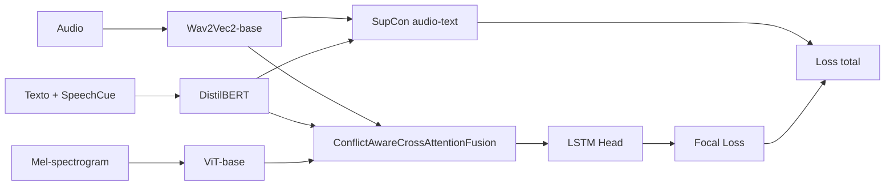

# Experimento 43: Conflict-Aware + mejoras de entrenamiento

**ID**: 43  
**Config**: `config/ablation/ablation_43_training_improvements.yaml`  
**Modelo**: `Ablation43Model`  
**Base**: Ablation 34  
**Objetivo**: evaluar si una receta de entrenamiento más fuerte mejora la separación entre clases y reduce errores en clases difíciles, manteniendo la arquitectura Conflict-Aware.

---

## Diagrama de bloques



---

## Hipótesis

Ablation 34 ya es una base fuerte por su fusión Conflict-Aware. El estudio 43 no cambia el núcleo de fusión; prueba si el entrenamiento puede mejorar mediante:

- **Focal Loss** para focalizar ejemplos difíciles.
- **Supervised Contrastive Loss** sobre embeddings de audio/texto.
- **Text augmentation** con random masking.
- Scheduler monitorizado por `val_ua` en lugar de `val_loss`.

---

## Cambios frente a Ablation 34

| Componente | Ablation 34 | Ablation 43 |
|------------|-------------|-------------|
| Modelo | Conflict-Aware | Conflict-Aware |
| Clase Python | `Ablation34Model` | `Ablation43Model` |
| Loss principal | Cross Entropy / según config | Focal Loss |
| Contrastive loss | No | Sí, audio+texto |
| Text augmentation | Normalmente desactivado | Activado |
| Scheduler metric | Según config | `val_ua` |

---

## Detalles del modelo

`Ablation43Model` extiende `Ablation34Model`. En `forward()`:

1. Ejecuta el forward estándar de Ablation 34.
2. Recupera `audio_features` y `text_features`.
3. Promedia ambas vistas por muestra.
4. Normaliza con L2.
5. Calcula una Supervised Contrastive Loss si `use_contrastive_loss: true`.

La salida añade `loss_contrastive`, que el loop de entrenamiento puede combinar con la pérdida principal según `contrastive_weight`.

---

## Configuración principal

| Parámetro | Valor |
|-----------|-------|
| `audio_encoder` | `facebook/wav2vec2-base` |
| `text_encoder` | `distilbert-base-uncased` |
| `vision_encoder` | `google/vit-base-patch16-224` |
| `fusion_type` | `conflict_aware_cross_attention` |
| `conflict_detection_method` | `prediction_divergence` |
| `classification_head_type` | `lstm` |
| `loss.type` | `focal` |
| `loss.gamma` | 2.0 |
| `loss.use_contrastive_loss` | `true` |
| `loss.contrastive_weight` | 0.1 |
| `loss.contrastive_temperature` | 0.07 |
| `scheduler_metric` | `val_ua` |
| `scheduler_mode` | `max` |

---

## Entrenamiento

```powershell
python scripts\run_ablation.py --study 43 --device cuda
```

El split es el estándar:

- Train: sesiones 1, 2, 3.
- Validación: sesión 4.
- Test: sesión 5.

---

## Interpretación esperada

Este estudio debe compararse contra Ablation 34 con especial atención a:

- UA macro y F1 macro, no solo WA.
- Métricas por clase, especialmente `neutral`.
- Separación de embeddings si se visualizan representaciones.
- Gap validación-test para detectar si la receta aumenta overfitting.

---

## Evaluación test-only

Si el entrenamiento ya terminó:

```powershell
python scripts\run_test_only.py --checkpoint_dir checkpoints\ablation_43\<run> --study 43 --device cuda
```

---

## Trazabilidad

- `src/ablation_studies/ablation_43_model.py`
- `config/ablation/ablation_43_training_improvements.yaml`
- `scripts/run_ablation.py`: `study_number == 43` -> `Ablation43Model`
- `src/utils/losses.py`: pérdidas base y componentes contrastivos

