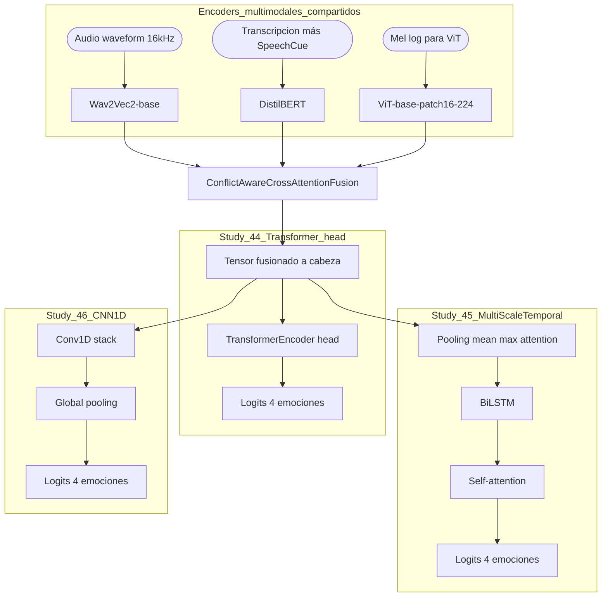
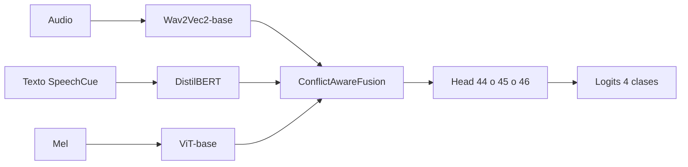

# Experimentos 44-46: Conflict-Aware con nuevas cabezas de clasificación

**IDs**: 44, 45, 46  
**Base**: mejor receta de Ablation 34  
**Modelo Python**: `Ablation34Model` con cambios declarados por YAML  
**Objetivo general**: aislar el efecto de la cabeza de clasificación manteniendo constante el encoder multimodal y la fusión Conflict-Aware.

---

## Diagrama a bloques (tronco comun y cabezas 44-46)

Cada estudio usa **un solo tipo de cabeza**; el diagrama agrupa las tres variantes para comparar el espacio de diseno.



Nota de lectura: en un entrenamiento real solo esta activa **una** de las tres ramas de cabeza; la fusion produce una sola secuencia o tensor que la cabeza configurada convierte en logits.

### Flujo simplificado (una linea)



---

## Qué se mantiene fijo

Los tres estudios conservan la familia arquitectónica de Ablation 34:

- `audio_encoder: facebook/wav2vec2-base`
- `text_encoder: distilbert-base-uncased`
- `vision_encoder: google/vit-base-patch16-224`
- `fusion_type: conflict_aware_cross_attention`
- `conflict_detection_method: prediction_divergence`
- `fusion_num_heads: 8`
- `fusion_num_layers: 3`
- `batch_size: 4`
- `gradient_accumulation_steps: 8`
- `loss.type: cross_entropy`
- `label_smoothing: 0.1`

La variable experimental es la cabeza.

---

## Ablation 44: Transformer Head

**Config**: `config/ablation/ablation_44_transformer_head.yaml`  
**Ejecución**:

```powershell
python scripts\run_ablation.py --study 44 --device cuda
```

### Hipótesis

Una cabeza Transformer puede capturar interacciones internas más flexibles en la representación fusionada que una LSTM final, especialmente si la salida de fusión conserva estructura temporal o pseudo-secuencial.

### Cambios principales

| Parámetro | Valor |
|-----------|-------|
| `classification_head_type` | `transformer` |
| `transformer_num_layers` | 1 |
| `transformer_num_heads` | 8 |
| `freeze_vision_encoder` | `false` |
| `vision_unfreeze_last_n_layers` | 6 |

### Riesgo principal

Puede sobreajustar si la cabeza tiene más capacidad que la señal disponible o si el batch efectivo no estabiliza la atención.

---

## Ablation 45: MultiScaleTemporal Head

**Config**: `config/ablation/ablation_45_multiscale_head.yaml`  
**Ejecución**:

```powershell
python scripts\run_ablation.py --study 45 --device cuda
```

### Hipótesis

La cabeza MultiScaleTemporal puede mejorar la clasificación al combinar pooling medio, máximo y atencional con LSTM y self-attention final. Busca retener información temporal y de escala antes de producir logits.

### Cambios principales

| Parámetro | Valor |
|-----------|-------|
| `classification_head_type` | `multi_scale_temporal` |
| `pooling_types` | `mean`, `max`, `attention` |
| `use_lstm` | `true` |
| `lstm_num_layers` | 2 |
| `lstm_hidden` | 512 |
| `use_self_attention` | `true` |
| `attention_heads` | 4 |
| `final_dropout` | 0.4 |

### Interpretación

Si mejora UA/F1 macro frente a 34 y 44, sugiere que la representación fusionada todavía contiene estructura temporal útil que la LSTM simple no explota completamente.

---

## Ablation 46: CNN1D Head

**Config**: `config/ablation/ablation_46_cnn1d_head.yaml`  
**Ejecución**:

```powershell
python scripts\run_ablation.py --study 46 --device cuda
```

### Hipótesis

Una cabeza CNN1D puede capturar patrones locales y ser más simple/regularizada que Transformer o MultiScaleTemporal.

### Cambios principales

| Parámetro | Valor |
|-----------|-------|
| `classification_head_type` | `cnn1d` |
| `cnn_num_layers` | 2 |
| `freeze_vision_encoder` | `true` |
| `vision_unfreeze_last_n_layers` | 4 |

### Interpretación

Si mantiene rendimiento competitivo con menor complejidad, puede ser útil como cabeza robusta y más barata computacionalmente.

---

## Comparación recomendada

| Study | Cabeza | Pregunta experimental |
|-------|--------|----------------------|
| 44 | Transformer | ¿Más atención final mejora la representación fusionada? |
| 45 | MultiScaleTemporal | ¿Pooling multiescala + LSTM + self-attention mejora UA/F1? |
| 46 | CNN1D | ¿Patrones locales bastan con menor complejidad? |

Comparar siempre contra Ablation 34 usando:

- WA.
- UA.
- F1 macro.
- Accuracy/F1 por clase.
- Gap entre validación y test.

---

## Evaluación test-only

```powershell
python scripts\run_test_only.py --checkpoint_dir checkpoints\ablation_44\<run> --study 44 --device cuda
python scripts\run_test_only.py --checkpoint_dir checkpoints\ablation_45\<run> --study 45 --device cuda
python scripts\run_test_only.py --checkpoint_dir checkpoints\ablation_46\<run> --study 46 --device cuda
```

---

## Trazabilidad

- `config/ablation/ablation_44_transformer_head.yaml`
- `config/ablation/ablation_45_multiscale_head.yaml`
- `config/ablation/ablation_46_cnn1d_head.yaml`
- `src/ablation_studies/classification_heads.py`
- `src/ablation_studies/ablation_34_model.py`
- `scripts/run_ablation.py`

