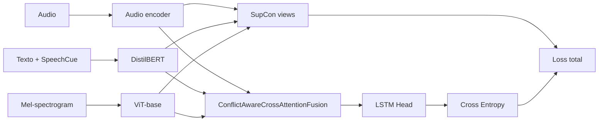

# Experimentos 47-50: Conflict-Aware + SupCon y encoders de audio

**IDs**: 47, 48, 49, 50  
**Familia**: Conflict-Aware Cross-Attention + Supervised Contrastive Loss  
**Objetivo general**: alinear representaciones por clase antes de la fusión, comparando además el impacto de Wav2Vec2, WavLM y Emotion2Vec como encoder de audio.

---

## Diagrama general



---

## Idea de SupCon

SupCon busca que muestras de la misma emoción queden cercanas en el espacio de embeddings, y que muestras de emociones distintas se separen. En esta serie:

- Ablation 47 usa 2 vistas: audio + texto.
- Ablation 48 usa 3 vistas: audio + texto + visión.
- Ablation 49 mantiene 3 vistas y cambia audio a WavLM-base.
- Ablation 50 mantiene 3 vistas y cambia audio a Emotion2Vec.

La pérdida total combina clasificación final con el término contrastivo:

```text
loss_total = loss_ce + contrastive_weight * loss_supcon
```

---

## Ablation 47: SupCon con 2 vistas

**Config**: `config/ablation/ablation_47_supcon.yaml`  
**Modelo**: `Ablation47Model`  
**Ejecución**:

```powershell
python scripts\run_ablation.py --study 47 --device cuda
```

### Hipótesis

Alinear audio y texto antes de la fusión debería ayudar a que Conflict-Aware reciba embeddings más coherentes por clase.

### Detalles

- Encoder audio: `facebook/wav2vec2-base`.
- Encoder texto: `distilbert-base-uncased`.
- Encoder visión: `google/vit-base-patch16-224`.
- SupCon sobre `audio_features` y `text_features`.
- `contrastive_weight: 0.1`.
- `contrastive_temperature: 0.1`.

---

## Ablation 48: SupCon con 3 vistas

**Config**: `config/ablation/ablation_48_supcon_3views.yaml`  
**Modelo**: `Ablation48Model`  
**Ejecución**:

```powershell
python scripts\run_ablation.py --study 48 --device cuda
```

### Hipótesis

Si la rama visual contiene información emocional complementaria, incluir visión en SupCon debe alinear las tres modalidades antes de la fusión y reducir conflictos espurios.

### Detalles

- Hereda la lógica de Ablation 47.
- Añade `vision_features` como tercera vista cuando está disponible.
- Si visión no está disponible, cae a 2 vistas.
- Mantiene Wav2Vec2-base como audio encoder.

---

## Ablation 49: SupCon 3 vistas + WavLM-base

**Config**: `config/ablation/ablation_49_supcon_wavlm.yaml`  
**Modelo**: `Ablation48Model`  
**Ejecución**:

```powershell
python scripts\run_ablation.py --study 49 --device cuda
```

### Hipótesis

WavLM-base debería mejorar la vista de audio por su preentrenamiento orientado a speech, ruido y características del hablante. Mantener SupCon 3 vistas permite comprobar si esa mejora se traduce en alineación multimodal.

### Cambios frente a 48

| Componente | Study 48 | Study 49 |
|------------|----------|----------|
| Audio encoder | `facebook/wav2vec2-base` | `microsoft/wavlm-base` |
| SupCon views | 3 | 3 |
| Modelo Python | `Ablation48Model` | `Ablation48Model` |

---

## Ablation 50: SupCon 3 vistas + Emotion2Vec

**Config**: `config/ablation/ablation_50_emotion2vec.yaml`  
**Modelo**: `Ablation48Model`  
**Requisito**:

```powershell
pip install funasr
```

**Ejecución**:

```powershell
python scripts\run_ablation.py --study 50 --device cuda
```

### Hipótesis

Emotion2Vec está preentrenado con foco emocional, por lo que podría generar embeddings más directamente útiles para SER que Wav2Vec2/WavLM. Este estudio mide si esa especialización compensa el coste de integrar FunASR.

### Cambios frente a 48

| Componente | Study 48 | Study 50 |
|------------|----------|----------|
| Audio encoder | `facebook/wav2vec2-base` | `emotion2vec/emotion2vec_base` |
| `audio_unfreeze_last_n_layers` | 6 | 0 |
| Dependencia extra | No | `funasr` |

---

## Configuración común

| Parámetro | Valor común |
|-----------|-------------|
| `fusion_type` | `conflict_aware_cross_attention` |
| `classification_head_type` | `lstm` |
| `fusion_num_heads` | 8 |
| `fusion_num_layers` | 3 |
| `conflict_detection_method` | `prediction_divergence` |
| `loss.type` | `cross_entropy` |
| `use_contrastive_loss` | `true` |
| `contrastive_weight` | 0.1 |
| `contrastive_temperature` | 0.1 |
| `batch_size` | 4 |
| `gradient_accumulation_steps` | 8 |

---

## Comparación recomendada

| Study | Vistas SupCon | Audio encoder | Pregunta experimental |
|-------|---------------|---------------|----------------------|
| 47 | audio + texto | Wav2Vec2-base | ¿SupCon bimodal ayuda antes de fusionar? |
| 48 | audio + texto + visión | Wav2Vec2-base | ¿La visión mejora la alineación contrastiva? |
| 49 | audio + texto + visión | WavLM-base | ¿WavLM mejora la vista de audio? |
| 50 | audio + texto + visión | Emotion2Vec | ¿Un encoder emocional especializado mejora SER? |

---

## Evaluación test-only

```powershell
python scripts\run_test_only.py --checkpoint_dir checkpoints\ablation_47\<run> --study 47 --device cuda
python scripts\run_test_only.py --checkpoint_dir checkpoints\ablation_48\<run> --study 48 --device cuda
python scripts\run_test_only.py --checkpoint_dir checkpoints\ablation_49\<run> --study 49 --device cuda
python scripts\run_test_only.py --checkpoint_dir checkpoints\ablation_50\<run> --study 50 --device cuda
```

---

## Trazabilidad

- `src/ablation_studies/ablation_47_supcon_model.py`
- `src/ablation_studies/ablation_48_supcon_model.py`
- `src/utils/losses.py` (`SupConLoss`)
- `config/ablation/ablation_47_supcon.yaml`
- `config/ablation/ablation_48_supcon_3views.yaml`
- `config/ablation/ablation_49_supcon_wavlm.yaml`
- `config/ablation/ablation_50_emotion2vec.yaml`

