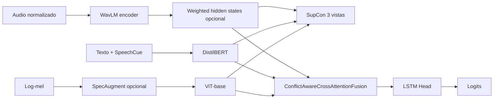

# Experimentos 52-54: WavLM, SpecAugment y weighted hidden states

**IDs**: 52, 53, 54  
**Familia**: SupCon 3 vistas + Conflict-Aware + WavLM  
**Nota**: el estudio 51 no está definido en `scripts/run_ablation.py`.

---

## Objetivo general

Esta serie parte de la idea de Ablation 49: WavLM-base + SupCon 3 vistas + Conflict-Aware. Luego prueba tres mejoras:

1. Quitar augmentación directa sobre waveform para no distorsionar la entrada de WavLM.
2. Aplicar SpecAugment en la rama visual sobre log-mel antes del resize a imagen.
3. Usar combinación aprendible de hidden states de WavLM.

---

## Diagrama general



---

## Ablation 52: WavLM + SupCon + SpecAugment en ViT

**Config**: `config/ablation/ablation_52_supcon_wavlm_specaug_vit.yaml`  
**Modelo**: `Ablation48Model`  
**Ejecución**:

```powershell
python scripts\run_ablation.py --study 52 --device cuda
```

### Hipótesis

La augmentación de waveform puede perjudicar a WavLM si altera demasiado la señal que el encoder espera. En cambio, aplicar SpecAugment en el log-mel de la rama visual puede regularizar ViT sin dañar directamente la representación acústica de WavLM.

### Cambios frente a Ablation 49

| Componente | Study 49 | Study 52 |
|------------|----------|----------|
| `audio.apply_waveform_augment` | `true` | `false` |
| Audio encoder | `microsoft/wavlm-base` | `microsoft/wavlm-base` |
| `vision_mel_spec_augment` | No | `true` |
| `vision_spec_augment.freq_mask_param` | N/A | 10 |
| `vision_spec_augment.time_mask_param` | N/A | 40 |
| `freeze_audio_encoder` | `false` | `true` |
| `freeze_vision_encoder` | `true` | `false` |

### Interpretación esperada

Si mejora validación/test, sugiere que WavLM se beneficia de señales menos perturbadas y que la regularización debe aplicarse preferentemente en la rama visual.

---

## Ablation 53: WavLM-base + weighted hidden states

**Config**: `config/ablation/ablation_53_wavlm_weighted_hidden_states.yaml`  
**Modelo**: `Ablation48Model`  
**Ejecución**:

```powershell
python scripts\run_ablation.py --study 53 --device cuda
```

### Hipótesis

Las capas de WavLM codifican información distinta: capas tempranas pueden representar rasgos acústicos, capas intermedias fonética/prosodia y capas finales información más abstracta. Una suma ponderada aprendible permite al modelo seleccionar la mezcla útil para SER.

### Cambios frente a 52

| Parámetro | Study 52 | Study 53 |
|-----------|----------|----------|
| `hidden_dim` | 512 | 768 |
| `dropout` | 0.5 | 0.2 |
| `batch_size` | 4 | 8 |
| `gradient_accumulation_steps` | 8 | 4 |
| `mixed_precision` | `false` | `true` |
| `learning_rate_fusion` | `5.0e-6` | `5.0e-4` |
| `scheduler_type` | `plateau` | `cosine_with_warmup` |
| `wavlm_weighted_hidden_states` | No | `true` |

### Detalle técnico

`wavlm_weighted_hidden_states: true` activa una combinación softmax-aprendida de los hidden states de WavLM antes del pooling temporal. Esto sigue la recomendación de aprovechar varias capas en lugar de depender únicamente de la última.

---

## Ablation 54: WavLM-base-plus + weighted hidden states

**Config**: `config/ablation/ablation_54_wavlm_base_plus_weighted.yaml`  
**Modelo**: `Ablation48Model`  
**Ejecución**:

```powershell
python scripts\run_ablation.py --study 54 --device cuda
```

### Hipótesis

`microsoft/wavlm-base-plus` podría mejorar sobre `microsoft/wavlm-base` bajo la misma lógica de weighted hidden states y SupCon 3 vistas.

### Cambios frente a 53

| Componente | Study 53 | Study 54 |
|------------|----------|----------|
| Audio encoder | `microsoft/wavlm-base` | `microsoft/wavlm-base-plus` |
| `wavlm_weighted_hidden_states` | `true` | `true` |
| `hidden_dim` | 768 | 768 |
| `mixed_precision` | `true` | `false` |
| `batch_size` | 8 | 4 |
| `freeze_text_encoder` | `true` | `false` |
| `scheduler_type` | `cosine_with_warmup` | `plateau` |

---

## Configuración común

| Parámetro | Valor |
|-----------|-------|
| `fusion_type` | `conflict_aware_cross_attention` |
| `classification_head_type` | `lstm` |
| `loss.type` | `cross_entropy` |
| `use_contrastive_loss` | `true` |
| `contrastive_weight` | 0.1 |
| `contrastive_temperature` | 0.1 |
| `vision_mel_spec_augment` | `true` |
| `vision_spec_augment.freq_mask_param` | 10 |
| `vision_spec_augment.time_mask_param` | 40 |

---

## Comparación recomendada

| Study | Cambio principal | Pregunta experimental |
|-------|------------------|----------------------|
| 52 | Sin waveform augmentation + SpecAugment en ViT | ¿Dónde conviene aplicar augmentación? |
| 53 | WavLM weighted hidden states | ¿Mezclar capas de WavLM mejora SER? |
| 54 | WavLM-base-plus | ¿Base+ mejora bajo protocolo similar? |

Métricas clave:

- UA y F1 macro.
- F1 de `neutral`.
- Gap val-test.
- Estabilidad del entrenamiento con/ sin mixed precision.
- Matriz de confusión para ver si mejora la separación `happy`/`neutral` o `angry`/`neutral`.

---

## Evaluación test-only

```powershell
python scripts\run_test_only.py --checkpoint_dir checkpoints\ablation_52\<run> --study 52 --device cuda
python scripts\run_test_only.py --checkpoint_dir checkpoints\ablation_53\<run> --study 53 --device cuda
python scripts\run_test_only.py --checkpoint_dir checkpoints\ablation_54\<run> --study 54 --device cuda
```

---

## Trazabilidad

- `config/ablation/ablation_52_supcon_wavlm_specaug_vit.yaml`
- `config/ablation/ablation_53_wavlm_weighted_hidden_states.yaml`
- `config/ablation/ablation_54_wavlm_base_plus_weighted.yaml`
- `src/ablation_studies/ablation_48_supcon_model.py`
- `scripts/run_ablation.py`
- `config/ablation/ABLATION_SUMMARY.md`

