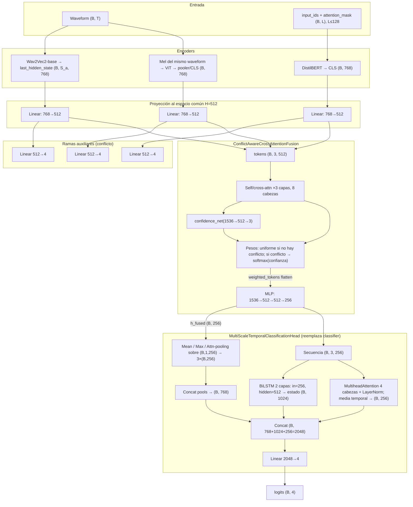

<!--
  Diagrama y descripción de la arquitectura del estudio 45 (Conflict-Aware trimodal
  + cabeza MultiScaleTemporal), con dimensiones según config por defecto y código
  en src/ablation_studies y src/models/fusion.py.
-->

# Ablation 45 — Arquitectura, dimensiones y funcionamiento

Configuración de referencia: `config/ablation/ablation_45_multiscale_head.yaml`.  
Hiperparámetros de fusión: `hidden_dim` del modelo **H = 512**, **8** cabezas, **3** capas de cross-attención.

## Diagrama (vista global)

Dimensiones típicas del *forward* con *batch size* **B** (encoder HF: Wav2Vec2-base, DistilBERT, ViT-base → **768** cada uno antes de proyectar).

## Funcionamiento (detalle)

El estudio **45** es un modelo **trimodal**: el audio en forma de **waveform** (16 kHz, longitud acotada en config) pasa por **Wav2Vec2-base**, que entrega una secuencia de *frames* acústicos; se reduce temporalmente a un vector **(B, 768)** mediante el *pooling* definido en la clase base (p. ej. media u otra estrategia del modelo multimodal). En paralelo, el **mismo** *batch* de audio genera un **log-mel** que se normaliza, reescala a imagen **224×224** y alimenta **ViT** (salida **B×768**); el texto (transcripción con **SpeechCue** si está activado en datos) pasa por **DistilBERT** y se toma la representación del **CLS** (**B×768**). Las tres modalidades se proyectan con lineales independientes al espacio común **H = 512**. Ahí operan tres clasificadores lineales débiles (**512→4**) cuyos *logits* permiten la **detección de conflicto** (en la config por defecto, *prediction divergence*: hay conflicto cuando al menos **dos** pares de modalidades predicen clases distintas). A continuación, los tres embeddings apilados forman **(B, 3, 512)** y recorren **tres** bloques de **MultiheadAttention** residual + LayerNorm (cada token “ve” a los tres), mezclando información entre modalidades. Un módulo de **confianza** lee el vector apilado **3H = 1536** y produce tres escalares en **[0,1]** por modalidad; si hay conflicto, los pesos por modalidad siguen esas confianzas normalizadas; si no, pesos **uniformes 1/3**. Esos pesos modulan los tokens antes de aplanarlos a **1536** y pasarlos por un **MLP** que termina en **h_fused ∈ ℝ^256** (en el código, `hidden_dim // 2`). Ese vector es la entrada de la **MultiScaleTemporalClassificationHead**: se infla a secuencia de longitud 1 en dimensión 256 y se obtienen tres representaciones (**mean**, **max** y **attention pooling** con query aprendido); en la práctica, con un solo paso temporal, mean y max coinciden, pero la rama atencional difiere. Esas tres vistas se concatenan (**768**); la misma tripleta apilada como *(B, 3, 256)* alimenta en paralelo un **BiLSTM** de dos capas con estado oculto **512** por dirección (**1024** al concatenar forward/backward) y una **autoatención** multi-cabeza cuya salida se promedia en el eje de la secuencia (**256**). Las tres piezas —**768 + 1024 + 256 = 2048**— se concatenan, se aplica *dropout* y una **única lineal** produce los **cuatro** *logits* de emoción. El entrenamiento usa la misma receta que el **34** salvo esta cabeza; la pérdida es entropía cruzada con *label smoothing* según el YAML.

## Referencias en código

- Ensamblaje del modelo y cabeza: `src/ablation_studies/ablation_34_model.py`
- *Forward* trimodal y encoders: `src/ablation_studies/ablation_11_model.py`
- Fusión y MLP a 256: `ConflictAwareCrossAttentionFusion` en `src/models/fusion.py`
- Cabeza multi-escala: `MultiScaleTemporalClassificationHead` en `src/ablation_studies/classification_heads.py`
