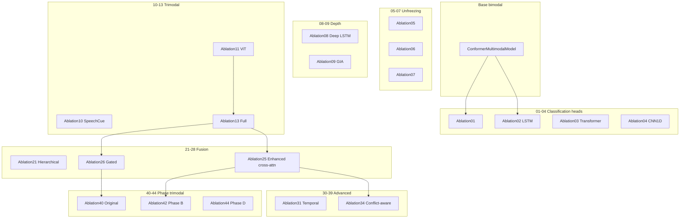

# CONFORMER-SER experiments overview

Canonical index for speech emotion recognition (SER) experiments on IEMOCAP (**four classes:** angry, happy, sad, neutral).

## Master experiment table

| Ablation | Name | Audio | Text | Visual | Fusion | Head | Results (test UA) |
|----------|------|-------|------|--------|--------|------|-------------------|
| 1 | Unfreeze encoders | Wav2Vec2-base | DistilBERT | - | Cross-attention | MLP | N/A |
| 2 | LSTM head | Wav2Vec2-base | DistilBERT | - | Cross-attention | LSTM | N/A |
| 3 | Transformer head | Wav2Vec2-base | DistilBERT | - | Cross-attention | Transformer | N/A |
| 4 | CNN1D head | Wav2Vec2-base | DistilBERT | - | Cross-attention | CNN1D | N/A |
| 5 | Unfreeze LSTM | Wav2Vec2-base | DistilBERT | - | Cross-attention | LSTM | N/A |
| 6 | Unfreeze Transformer | Wav2Vec2-base | DistilBERT | - | Cross-attention | Transformer | N/A |
| 7 | Unfreeze mid–high | Wav2Vec2-base | DistilBERT | - | Cross-attention | LSTM | N/A |
| 8 | Deep LSTM | Wav2Vec2-base | DistilBERT | - | Cross-attention | Deep LSTM | N/A |
| 9 | GIA LSTM | Wav2Vec2-base | DistilBERT | - | GIA | LSTM | N/A |
| 10 | SpeechCue internal | Wav2Vec2-base | DistilBERT+SpeechCue | - | Cross-attention | LSTM | N/A |
| 11 | MelSpec ViT | Wav2Vec2-base | DistilBERT | ViT (Mel) | Trimodal cross-attn | LSTM | N/A |
| 12 | SpeechCue LOSO | Wav2Vec2-base | DistilBERT+SpeechCue | - | Cross-attention | LSTM | N/A |
| 13 | MelSpec+SpeechCue+unfreeze | Wav2Vec2-base | DistilBERT+SpeechCue | ViT | Trimodal cross-attn | LSTM | N/A |
| 14–20 | Variants of 13 | Wav2Vec2-base | DistilBERT | ViT | Various | LSTM | N/A |
| 21 | Hierarchical fusion | Wav2Vec2-base | DistilBERT+SpeechCue | ViT | Hierarchical | LSTM | N/A |
| 22 | Tensor fusion | Wav2Vec2-base | DistilBERT+SpeechCue | ViT | Tensor fusion | LSTM | N/A |
| 23 | Bilinear fusion | Wav2Vec2-base | DistilBERT+SpeechCue | ViT | Bilinear | LSTM | N/A |
| 24 | Adaptive weighted | Wav2Vec2-base | DistilBERT+SpeechCue | ViT | Adaptive weighted | LSTM | N/A |
| 25 | Enhanced cross-attention | Wav2Vec2-base | DistilBERT+SpeechCue | ViT | Enhanced cross-attn | LSTM | N/A |
| 26 | Gated fusion | Wav2Vec2-base | DistilBERT+SpeechCue | ViT | Gated (GMU) | LSTM | N/A |
| 27 | Late fusion | Wav2Vec2-base | DistilBERT+SpeechCue | ViT | Late | LSTM | N/A |
| 28 | GLU fusion | Wav2Vec2-base | DistilBERT+SpeechCue | ViT | GLU | LSTM | N/A |
| 30 | Dirichlet | Wav2Vec2-base | DistilBERT+SpeechCue | ViT | Enhanced cross-attn | Dirichlet | N/A |
| 31 | Temporal alignment | Wav2Vec2-base | DistilBERT+SpeechCue | ViT | Enhanced + DTW | LSTM | N/A |
| 32 | Temporal bucketing | Wav2Vec2-base | DistilBERT+SpeechCue | ViT | Enhanced + buckets | LSTM | N/A |
| 33 | Noise-aware SpeechCue | Wav2Vec2-base | DistilBERT+SpeechCue | ViT | Enhanced cross-attn | LSTM | N/A |
| 34 | Conflict-aware attention | Wav2Vec2-base | DistilBERT+SpeechCue | ViT | Conflict-aware | LSTM | **53.78%** |
| 35–39 | Advanced | Wav2Vec2-base | DistilBERT | ViT | Various | Various | N/A |
| 40 | Original trimodal | WavLM-large | RoBERTa+SpeechCue | ViT | Gated | LSTM | Val UA (best_metrics): 43.35% |
| 41 | Phase A trimodal | WavLM-large | RoBERTa+SpeechCue | ViT | Gated | LSTM | N/A |
| 42 | Phase B trimodal | WavLM-large | RoBERTa+SpeechCue | ViT | Enhanced cross-attn | LSTM | N/A |
| 43 | Phase C trimodal | WavLM-large | RoBERTa+SpeechCue | ViT | Enhanced cross-attn | LSTM | N/A |
| 44 | Phase D trimodal | WavLM-large | RoBERTa+SpeechCue | ViT | Enhanced + SupCon | LSTM | N/A |
| phaseB | Phase B (bimodal) | WavLM-large | RoBERTa+SpeechCue | - | Sequence GIA | - | Val UA: 56.80% |
| phaseC | Phase C (bimodal) | WavLM-large | RoBERTa+SpeechCue | - | Sequence GIA | - | Val UA: 57.90% |
| wavlm_gated_v2 | WavLM gated v2 | WavLM-large | RoBERTa | - | Gated | - | Val UA: 51.46% |

**UA** = unweighted accuracy. **Val UA** rows come from `best_metrics.json` (validation). **Test UA** rows come from `final_results.json` (test) where available.

## Group and inheritance diagram



## Typical hidden sizes

| Component | Wav2Vec2-base | WavLM-large | DistilBERT | RoBERTa | ViT-base |
|-----------|---------------|-------------|------------|---------|----------|
| hidden_size | 768 | 1024 | 768 | 768 | 768 |
| Pooled output | (B, 768) | (B, 1024) | (B, 768) | (B, 768) | (B, 768) |

## Phase documentation

- [01–04: Classification heads](phases/01-04_classification_heads.md) — LSTM, Transformer, CNN1D
- [05–07: Unfreezing](phases/05-07_unfreezing.md) — Fine-tuning strategies
- [08–09: Depth and fusion](phases/08-09_depth_fusion.md) — Deep LSTM, GIA
- [10–13: SpeechCue and visual](phases/10-13_speechcue_visual.md) — SpeechCue, Mel + ViT, variants
- [21–28: Fusion mechanisms](phases/21-28_fusion_mechanisms.md) — Hierarchical, tensor, bilinear, etc.
- [30–39: Advanced multimodal](phases/30-39_advanced_multimodal.md) — Dirichlet, temporal, conflict-aware, etc.
- [40–44: Phase trimodal](phases/40-44_phase_trimodal.md) — WavLM + RoBERTa + ViT

YAML filenames and one-line goals: [ablation-configs.md](ablation-configs.md) and [`../../config/ablation/ABLATION_SUMMARY.md`](../../config/ablation/ABLATION_SUMMARY.md).

## Run commands (PowerShell)

```powershell
# Run one ablation study
python scripts/run_ablation.py --study 34

# Optional: custom dataset root
python scripts/run_ablation.py --study 40 --data_path "F:/path/to/IEMOCAP_full_release"
```

## Default experimental setup

- **Dataset:** IEMOCAP — four train sessions + one val + session 5 test
- **Classes:** angry, happy, sad, neutral
- **Sample rate:** 16 kHz
- **Max audio length:** 8 s
