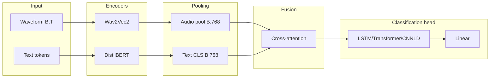

# Ablations 01–04: Classification heads

## Objective

Choose the best architecture to process fused features before the final prediction. The bimodal backbone (Wav2Vec2 + DistilBERT) is fixed; only the **classification head** changes.

## Studies in this group

| Ablation | Head | Description |
|----------|------|-------------|
| 01 | MLP (default) | Baseline with partially unfrozen encoders |
| 02 | LSTM | Bidirectional LSTM for temporal structure |
| 03 | Transformer | Single Transformer encoder layer on fused tokens |
| 04 | CNN1D | 1D convolutions for local patterns |

## Architecture (high level)

## Shapes by stage

| Stage | Abl. 01 (MLP) | Abl. 02 (LSTM) | Abl. 03 (Transformer) | Abl. 04 (CNN1D) |
|-------|---------------|----------------|-------------------------|------------------|
| Audio encoder out | (B, T_a, 768) | (B, T_a, 768) | (B, T_a, 768) | (B, T_a, 768) |
| Audio pooled | (B, 768) | (B, 768) | (B, 768) | (B, 768) |
| Text encoder out | (B, 768) | (B, 768) | (B, 768) | (B, 768) |
| Fusion out | (B, hidden_dim) | (B, hidden_dim) | (B, hidden_dim) | (B, hidden_dim) |
| Head input | (B, hidden_dim) | (B, 1, hidden_dim) | (B, 1, hidden_dim) | (B, hidden_dim) |
| Head output | (B, 4) | (B, 4) | (B, 4) | (B, 4) |

**hidden_dim** is typically **256** in config.

## Per-ablation notes

### Ablation 01: Unfreeze encoders

- **Fusion:** Cross-attention (concat + MLP path)
- **Head:** MLP inside the fusion module
- **Unfreeze:** 4 audio layers, 2 text layers
- **Loss:** Focal (gamma=2, label smoothing 0.1)

### Ablation 02: LSTM head

- **Fusion:** Cross-attention
- **Head:** 2-layer bidirectional LSTM, projected to `hidden_dim`
- **Encoders:** Often frozen (per experiment design)
- **LSTM output:** (B, hidden_dim×2) → projection → (B, 4)

### Ablation 03: Transformer head

- **Head:** Transformer encoder (1 layer) on the fused sequence
- **Output:** CLS or mean pooling → `Linear(4)`

### Ablation 04: CNN1D head

- **Head:** Conv1D stack on concatenated fused features
- **Output:** Global pooling → `Linear(4)`

## Shared hyperparameters (typical)

| Parameter | Value |
|-----------|-------|
| batch_size | 2 |
| gradient_accumulation_steps | 8 |
| learning_rate_audio | 5e-7 (01) / 1e-6 (02) |
| learning_rate_text | 1e-6 (01) / 2e-6 (02) |
| learning_rate_fusion | 5e-5 |
| weight_decay | 0.1 |
| dropout | 0.3 |
| early_stopping_patience | 15 |

## Config files

- [`config/ablation/ablation_01_unfreeze_encoders.yaml`](../../../config/ablation/ablation_01_unfreeze_encoders.yaml)
- [`config/ablation/ablation_02_lstm_head.yaml`](../../../config/ablation/ablation_02_lstm_head.yaml)
- [`config/ablation/ablation_03_transformer_head.yaml`](../../../config/ablation/ablation_03_transformer_head.yaml)
- [`config/ablation/ablation_04_cnn1d_head.yaml`](../../../config/ablation/ablation_04_cnn1d_head.yaml)

## Source modules

- [`src/ablation_studies/ablation_01_model.py`](../../../src/ablation_studies/ablation_01_model.py)
- [`src/ablation_studies/ablation_02_model.py`](../../../src/ablation_studies/ablation_02_model.py)
- [`src/ablation_studies/ablation_03_model.py`](../../../src/ablation_studies/ablation_03_model.py)
- [`src/ablation_studies/ablation_04_model.py`](../../../src/ablation_studies/ablation_04_model.py)
- [`src/ablation_studies/classification_heads.py`](../../../src/ablation_studies/classification_heads.py)
