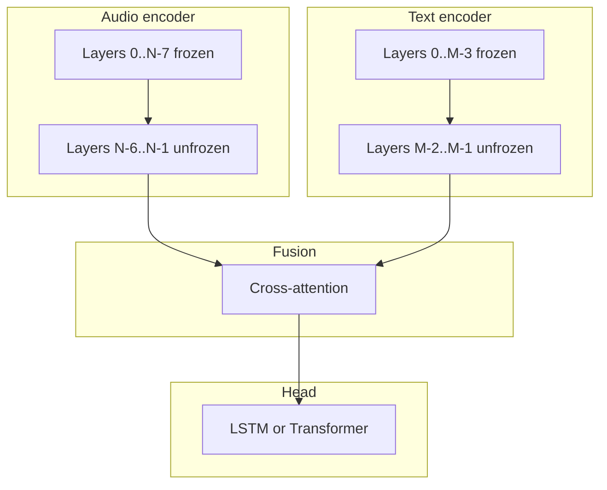

# Ablations 05–07: Fine-tuning / unfreezing

## Objective

Decide which layers of Wav2Vec2 and DistilBERT should train vs stay frozen for best SER performance.

## Studies in this group

| Ablation | Head | Unfreezing strategy |
|----------|------|---------------------|
| 05 | LSTM | Standard partial unfreeze + LSTM head |
| 06 | Transformer | Same unfreeze as 05, Transformer head |
| 07 | LSTM | Only mid–high layers unfrozen |

## Architecture (high level)

## Strategies

### Ablation 05: Unfreeze LSTM

- **Audio:** Last **N** layers trainable (configurable).
- **Text:** Last **M** layers trainable (configurable).
- **Head:** Bidirectional LSTM.

### Ablation 06: Unfreeze Transformer

- Same unfreezing as 05 with a **Transformer** classification head (one encoder layer).

### Ablation 07: Mid–high unfreeze

- **Audio / text:** Only **mid–upper** blocks train; low-level features stay frozen to limit overfitting.

## Typical dimensions

| Component | Size |
|-----------|------|
| Wav2Vec2 layers (base) | 12 |
| DistilBERT layers | 6 |
| Audio hidden | 768 |
| Text hidden | 768 |
| Fusion hidden_dim | 256 |

## Config highlights

### Ablation 05

- `audio_unfreeze_last_n_layers: 4`
- `text_unfreeze_last_n_layers: 2`
- `classification_head_type: "lstm"`

### Ablation 06

- Same unfreeze as 05
- `classification_head_type: "transformer"`

### Ablation 07

- Mid–high unfreeze (see YAML)
- `classification_head_type: "lstm"`

## Files

- [`config/ablation/ablation_05_unfreeze_lstm.yaml`](../../../config/ablation/ablation_05_unfreeze_lstm.yaml)
- [`config/ablation/ablation_06_unfreeze_transformer.yaml`](../../../config/ablation/ablation_06_unfreeze_transformer.yaml)
- [`config/ablation/ablation_07_unfreeze_mid_high_lstm.yaml`](../../../config/ablation/ablation_07_unfreeze_mid_high_lstm.yaml)
- [`src/ablation_studies/ablation_05_model.py`](../../../src/ablation_studies/ablation_05_model.py)
- [`src/ablation_studies/ablation_06_model.py`](../../../src/ablation_studies/ablation_06_model.py)
- [`src/ablation_studies/ablation_07_model.py`](../../../src/ablation_studies/ablation_07_model.py)
