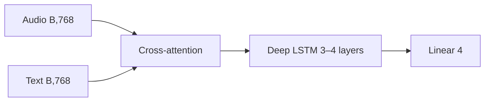
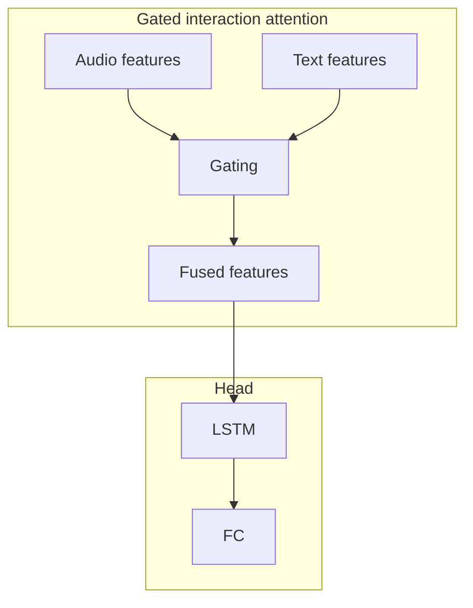

# Ablations 08–09: Depth and early fusion

## Objective

Increase modeling capacity with deeper LSTMs and **Gated Interaction Attention (GIA)** before classification.

## Studies in this group

| Ablation | Change | Description |
|----------|--------|-------------|
| 08 | Deep LSTM | More LSTM layers for a wider temporal receptive field |
| 09 | GIA LSTM | GIA as an early fusion module |

## Ablation 08: Deep LSTM

- **Head:** 3–4 bidirectional LSTM layers (config-dependent).
- **Output:** Concat forward/backward hidden states → projection → logits.

## Ablation 09: GIA LSTM

- **GIA:** Learnable gates mix audio and text streams.
- **Alternatives:** `SequenceLevelGIAFusion` for sequence-level mixing.

## Shapes

| Stage | 08 | 09 |
|-------|----|----|
| Audio encoder | (B, T_a, 768) | (B, T_a, 768) |
| Text encoder | (B, 768) | (B, 768) |
| GIA / fusion | (B, hidden_dim) | (B, hidden_dim) |
| LSTM out | (B, hidden_dim×2) | (B, hidden_dim×2) |
| Logits | (B, 4) | (B, 4) |

## Config

### Ablation 08

- `lstm_num_layers`: 3–4
- `fusion_type: "cross_attention"`

### Ablation 09

- `fusion_type: "gia"` or `"sequence_level_gia"`

## Files

- [`config/ablation/ablation_08_deep_lstm.yaml`](../../../config/ablation/ablation_08_deep_lstm.yaml)
- [`config/ablation/ablation_09_gia_lstm.yaml`](../../../config/ablation/ablation_09_gia_lstm.yaml)
- [`src/ablation_studies/ablation_08_model.py`](../../../src/ablation_studies/ablation_08_model.py)
- [`src/ablation_studies/ablation_09_model.py`](../../../src/ablation_studies/ablation_09_model.py)
- [`src/models/fusion.py`](../../../src/models/fusion.py) (`GIAFusion`, `SequenceLevelGIAFusion`)
