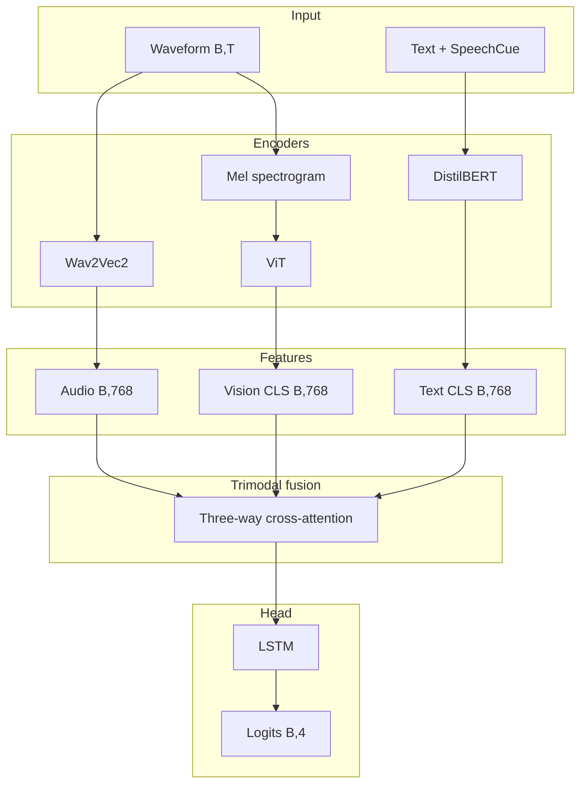

# Ablations 10–13: SpeechCue, visual, and trimodal variants

## Objective

Add **visual** Mel-spectrogram features (ViT) and **SpeechCue** prosody-aware text, establishing the main trimodal baseline for later fusion work.

## Studies in this group

| Ablation | Name | Audio | Text | Visual | Fusion |
|----------|------|-------|------|--------|--------|
| 10 | SpeechCue internal | Wav2Vec2 | DistilBERT+SpeechCue | - | Cross-attention |
| 11 | MelSpec ViT | Wav2Vec2 | DistilBERT | ViT (Mel) | Trimodal cross-attn |
| 12 | SpeechCue LOSO | Wav2Vec2 | DistilBERT+SpeechCue | - | Cross-attention |
| 13 | MelSpec+SpeechCue+unfreeze | Wav2Vec2 | DistilBERT+SpeechCue | ViT | Trimodal cross-attn |
| 14–20 | Variants of 13 | Wav2Vec2 | DistilBERT | ViT | Various |

## Trimodal stack (11 / 13)



## Detailed shapes

| Stage | Shape | Notes |
|-------|--------|-------|
| Waveform | (B, T) | Up to ~8 s at 16 kHz |
| Mel | (B, 80, T_mel) | 80 mels, hop 160 |
| Mel → image | (B, 3, 224, 224) | Resize + channel repeat for ViT |
| ViT tokens | (B, 197, 768) | 196 patches + CLS |
| Vision pooled | (B, 768) | CLS |
| Audio pooled | (B, 768) | Pooling / attention |
| Text pooled | (B, 768) | CLS |
| Fusion hidden | (B, hidden_dim) | Often 256 |
| LSTM input | (B, 1, fusion_dim) | Depends on fusion output |
| Logits | (B, 4) | Four classes |

## SpeechCue (10, 12, 13)

- **Idea:** Inject lightweight prosody tags into the transcript before BERT.
- **Example:** `[SPEAKER: male] [EMPHASIS: word] The weather is nice`
- **Config:** `text.use_prosody_cues: true`

## Visual branch (11, 13)

1. Mel transform from waveform (e.g. 80 mels).
2. Log + per-sample normalization.
3. Resize to 224×224.
4. Repeat to 3 channels for ViT.
5. **ViT:** `google/vit-base-patch16-224`, CLS pooling.

## Variants 13 (14–20)

| Study | Config | Purpose |
|-------|--------|---------|
| 14 (13a) | regularized | Dropout / weight decay |
| 15 (13b) | no SpeechCue | Ablate SpeechCue |
| 16 (13c) | frozen ViT | **Base for fusion 21–28** |
| 17 (13d) | high_reg | Strong regularization |
| 18 (13e) | advanced_reg | Label smoothing, Mixup |
| 19 (13f) | focal_loss | Focal loss |
| 20 (13d kfold) | kfold | K-fold protocol |

## Key settings (13c — fusion 21–28 base)

```yaml
model:
  audio_encoder: facebook/wav2vec2-base
  text_encoder: distilbert-base-uncased
  vision_encoder: google/vit-base-patch16-224
  freeze_vision_encoder: true
  audio_unfreeze_last_n_layers: 6
  text_unfreeze_last_n_layers: 4
  hidden_dim: 256
  fusion_type: cross_attention
  fusion_num_heads: 4
```

## Files

- [`src/ablation_studies/ablation_10_model.py`](../../../src/ablation_studies/ablation_10_model.py)
- [`src/ablation_studies/ablation_11_model.py`](../../../src/ablation_studies/ablation_11_model.py)
- [`src/ablation_studies/ablation_13_model.py`](../../../src/ablation_studies/ablation_13_model.py)
- [`config/ablation/ablation_13c_frozen_vit.yaml`](../../../config/ablation/ablation_13c_frozen_vit.yaml)
