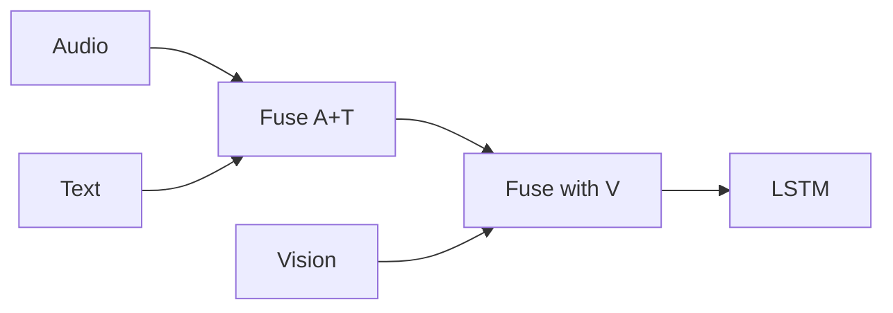
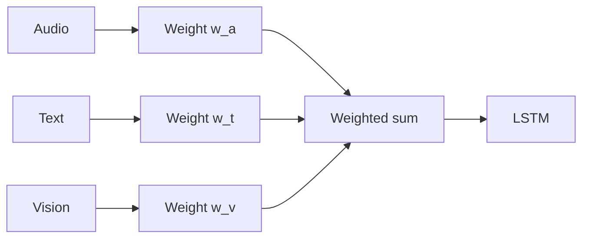
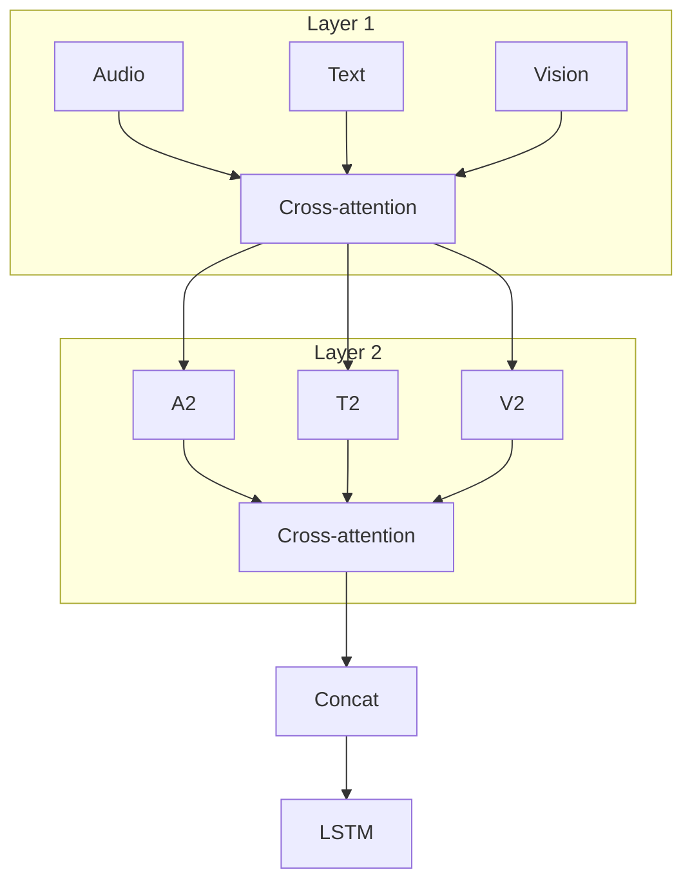

# Ablations 21–28: Advanced fusion mechanisms

## Objective

Hold the **13c** trimodal setup fixed (Wav2Vec2 + DistilBERT + SpeechCue + **frozen ViT**) and swap **only** the multimodal fusion block to compare integration strategies.

## Common base (Ablation 13c)

- **Audio:** Wav2Vec2-base, 768-d, last **6** transformer layers trainable.
- **Text:** DistilBERT + SpeechCue, 768-d, last **4** layers trainable.
- **Vision:** Frozen ViT on Mel 224×224, 768-d CLS.
- **Head:** 2-layer bidirectional LSTM.

## Studies in this group

| Ablation | Fusion | Description |
|----------|--------|-------------|
| 21 | Hierarchical | Audio+text → then fuse with vision |
| 22 | Tensor fusion | Outer product of the three modalities |
| 23 | Bilinear | Low / full bilinear pairwise interactions |
| 24 | Adaptive weighted | Learned scalar weights per modality |
| 25 | Enhanced cross-attention | Stacked cross-attention (strong baseline for 31–35) |
| 26 | Gated (GMU) | Gated multimodal units |
| 27 | Late fusion | Independent towers; merge logits late |
| 28 | GLU fusion | Gated linear units for nonlinear mixing |

## Hierarchical (21)



## Tensor fusion (22)

- **Idea:** Outer product \(\otimes\) across modality vectors (with bias tricks in TFN-style blocks).
- **Cost:** High memory / compute.

## Bilinear (23)

- **Idea:** Learned bilinear maps for modality pairs.

## Adaptive weighted (24)



## Enhanced cross-attention (25)



- **Depth:** typically **3** cross-attention layers, **4** heads.

## Gated fusion (26)

- Learned gates **g_a**, **g_t**, **g_v** scale each modality before summation.

## Late fusion (27)

- Each modality has its own trunk; logits or probabilities merge at the end.

## GLU fusion (28)

- `GLU(x) = x ⊙ σ(Wx)` style gating for efficient nonlinear fusion.

## Shapes (Ablation 25 reference)

| Stage | Shape |
|-------|--------|
| Modal inputs | (B, 768) each |
| Projected dim | (B, hidden_dim=256) |
| Cross-attention layers | 3 |
| Fusion output | (B, hidden_dim/2=128) typical |
| LSTM → logits | (B, 4) |

## Example YAML (25)

```yaml
model:
  fusion_type: enhanced_cross_attention
  fusion_num_heads: 4
  fusion_num_layers: 3
  hidden_dim: 256
```

## Files

- [`src/ablation_studies/ablation_21_model.py`](../../../src/ablation_studies/ablation_21_model.py) … through `ablation_28_model.py`
- [`src/models/fusion.py`](../../../src/models/fusion.py) — `TriModalHierarchicalFusion`, `TriModalTensorFusion`, etc.
- [`config/ablation/ablation_25_enhanced_cross_attention.yaml`](../../../config/ablation/ablation_25_enhanced_cross_attention.yaml)
