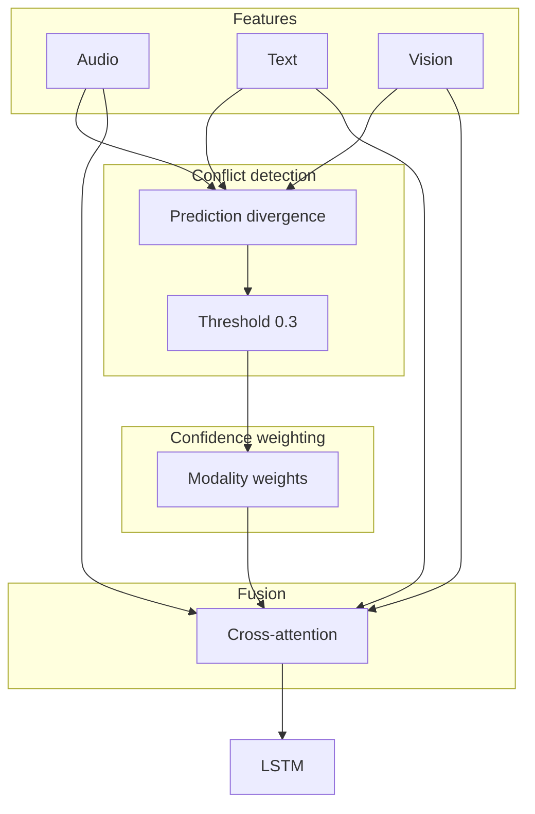
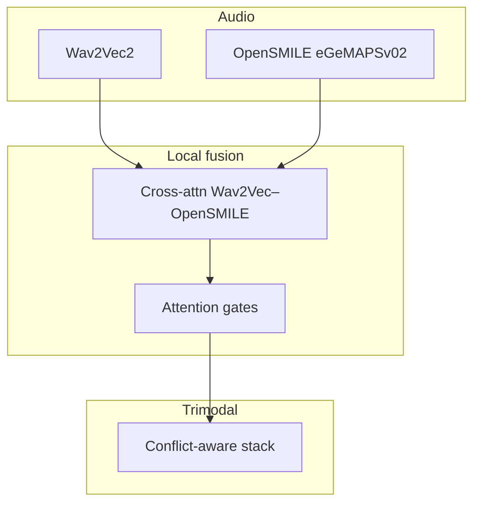

# Ablations 30–39: Advanced multimodal techniques

## Objective

Improve multimodal alignment, robustness, and conflict handling. Most studies build on **Ablation 25** (enhanced cross-attention). Some 36–39 variants branch from **Ablation 34** (conflict-aware).

## Common base

- **Default:** Ablation 25 — Wav2Vec2 + DistilBERT + SpeechCue + ViT with enhanced cross-attention.
- **Exception:** 36a/b/c, 37, 38, 39 may use Ablation 34 as architectural base.

## Studies in this group

| Ablation | Name | Base | Modification |
|----------|------|------|----------------|
| 30 | Dirichlet | 25 | Dirichlet / evidential-style uncertainty objective |
| 31 | Temporal alignment | 25 | Differentiable / adaptive DTW alignment |
| 32 | Temporal bucketing | 25 | ~400 ms windows, per- bucket fusion + LSTM |
| 33 | Noise-aware SpeechCue | 25 | `[UNCERTAIN]` token when audio looks noisy |
| 34 | Conflict-aware attention | 25 | Detect modality disagreement, confidence weighting |
| 35 | Modal-stratified AL | 25 | Active learning stratified by confused modality |
| 36a | Dirichlet + conflict | 25/34 | Combine objectives |
| 36b | Focal + conflict | 25/34 | Focal loss + conflict-aware fusion |
| 36c | Hybrid conflict | 25/34 | Hybrid variant |
| 37 | Dirichlet conflict-aware | 34 | Dirichlet on conflict-aware backbone |
| 38 | OpenSMILE residual | 34 | OpenSMILE eGeMAPS + attention gates + residual |
| 39 | SOTA improvements | 34 | Stacked “best practices” tweaks |

## Ablation 34: Conflict-aware cross-attention (example numbers)

**Test run** (example checkpoint id; yours may differ):

- **UA:** 53.78%
- **WA:** 58.47%
- **Macro F1:** 53.55%
- **Per class:** Angry 67.7%, Happy 53.2%, Sad 45.0%, Neutral 48.3%

### Architecture sketch



- **Detection:** `prediction_divergence` across modality-wise predictions.
- **Threshold:** 0.3 (typical).
- **Resolution:** Confidence-weighted fusion when conflict is high.

### Example YAML (34)

```yaml
model:
  hidden_dim: 512
  dropout: 0.25
  fusion_type: conflict_aware_cross_attention
  fusion_num_heads: 8
  fusion_num_layers: 3
  conflict_aware:
    conflict_detection_method: prediction_divergence
    conflict_threshold: 0.3
    confidence_weighting: true
```

## Ablation 31: Temporal alignment

- **Module:** Learned time-warping / DTW-style alignment before fusion.
- **Goal:** Reduce audio–text asynchrony.

## Ablation 32: Temporal bucketing

- **Buckets:** ~400 ms with overlap.
- **Fusion:** Local trimodal fusion per bucket.
- **Temporal model:** LSTM over bucket embeddings.

## Ablation 33: Noise-aware SpeechCue

- **Detector:** SNR / noise proxy from audio.
- **Effect:** Down-weight unreliable prosody cues in text.

## Ablation 38: OpenSMILE + gates + residual



- **OpenSMILE:** eGeMAPSv02 (~88-d features).
- **Gates:** Filter relevant hand-crafted features.
- **Residual:** Preserve original representations.

## Shapes (34 reference)

| Component | Shape |
|-----------|--------|
| Modal inputs | (B, 768) |
| hidden_dim | 512 |
| fusion output | (B, 256) typical |
| Logits | (B, 4) |

## Files

- [`src/ablation_studies/ablation_30_dirichlet.py`](../../../src/ablation_studies/ablation_30_dirichlet.py)
- [`src/ablation_studies/ablation_31_model.py`](../../../src/ablation_studies/ablation_31_model.py)
- [`src/ablation_studies/ablation_34_model.py`](../../../src/ablation_studies/ablation_34_model.py)
- [`src/ablation_studies/ablation_38_model.py`](../../../src/ablation_studies/ablation_38_model.py)
- [`src/models/fusion.py`](../../../src/models/fusion.py) — `ConflictAwareCrossAttentionFusion`, etc.
