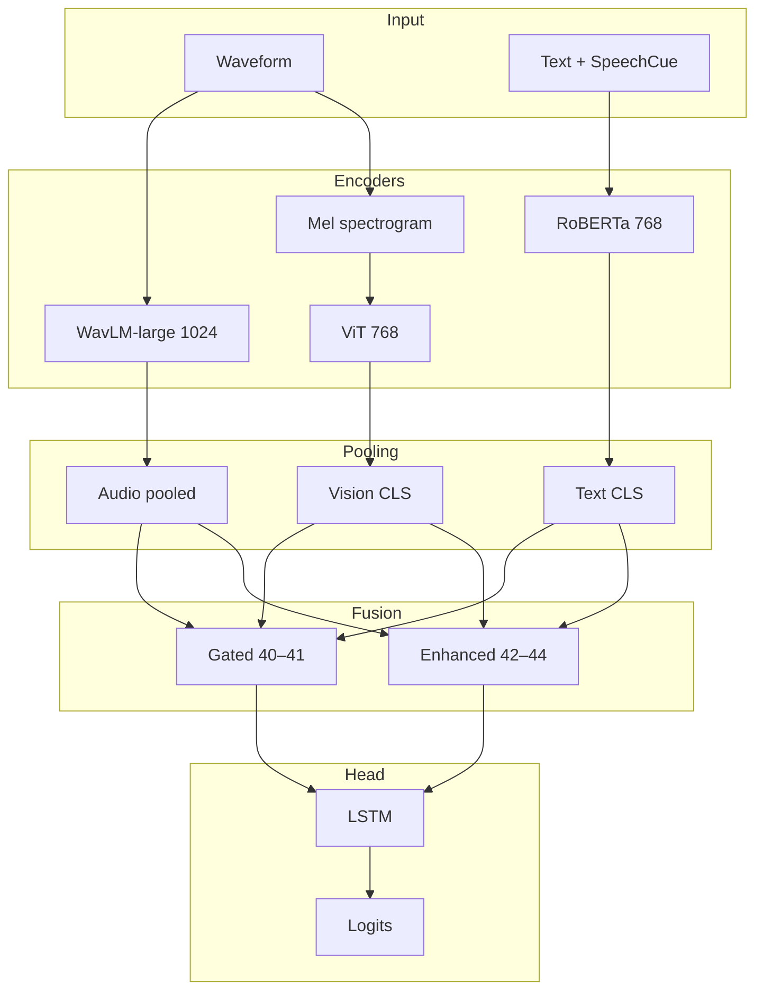
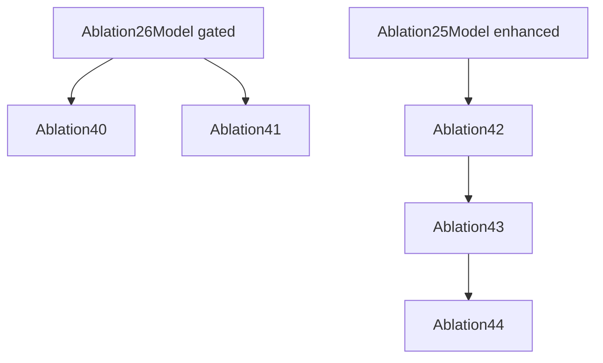

# Ablations 40–44: Phase trimodal (WavLM + RoBERTa + ViT)

## Objective

Map **Original (v1)**, **Phase A–D** trimodal setups to ablation IDs, always including the **visual** Mel → ViT branch. Encoders switch from Wav2Vec2/DistilBERT to **WavLM-large** and **RoBERTa**.

## Phase mapping

| Ablation | Phase | Fusion | Key differences |
|----------|-------|--------|-----------------|
| 40 | Original (v1) | TriModal gated | 8 audio + 4 text layers; focal loss without sqrt dampening |
| 41 | Phase A | TriModal gated | Encoders start frozen; +4/+4 unfreeze |
| 42 | Phase B | TriModal enhanced cross-attn | Layer aggregation, attentive statistical pooling |
| 43 | Phase C | TriModal enhanced cross-attn | + gradient checkpointing, R-Drop |
| 44 | Phase D | TriModal enhanced cross-attn | + cross-modal contrastive, SupCon, center, Mixup |

## Trimodal backbone



## Component shapes

| Component | Shape | Notes |
|-----------|--------|-------|
| WavLM-large | (B, T, 1024) | hidden 1024 |
| RoBERTa-base | (B, 768) | CLS |
| ViT-base | (B, 768) | CLS |
| hidden_dim (40–41) | 768 | Larger than 13c |
| Fusion 40–41 | TriModal gated | GMU-style |
| Fusion 42–44 | TriModal enhanced | Multi-layer cross-attention |

## Ablation 40: Original trimodal

- **Unfreeze:** 8 audio + 4 text layers.
- **Loss:** Focal (γ=2, label smoothing 0.05), no `class_weight_dampening` sqrt trick.
- **Example val metrics:** UA 43.35%, WA 29.72% (`best_metrics` — illustrative run).

## Ablation 41: Phase A

- Start from frozen encoders; unfreeze **4** audio + **4** text blocks.
- **Fusion:** Gated.

## Ablation 42: Phase B

- **Layer aggregation** for audio transformer stack.
- **Attentive statistical pooling** instead of naive mean.
- **Fusion:** Enhanced cross-attention.

## Ablation 43: Phase C

- Inherits 42.
- **Gradient checkpointing** for memory.
- **R-Drop** regularization (α≈0.1).

## Ablation 44: Phase D

- Inherits 43.
- **Cross-modal contrastive** projections (`audio_proj`, `text_proj`).
- **SupCon**, **center loss**, **Mixup** in feature space.

### Forward outputs (44)

The forward pass returns `fused_features`, `audio_proj`, `text_proj`, `logits`, `predictions` for auxiliary objectives.

## Inheritance diagram



## Example YAML (40)

```yaml
model:
  audio_encoder: microsoft/wavlm-large
  text_encoder: roberta-base
  vision_encoder: google/vit-base-patch16-224
  freeze_audio_encoder: false
  audio_unfreeze_last_n_layers: 8
  text_unfreeze_last_n_layers: 4
  freeze_vision_encoder: true
  hidden_dim: 768
  fusion_type: cross_attention  # Routed to TriModal gated internally
```

## Files

- [`src/ablation_studies/ablation_40_original_trimodal.py`](../../../src/ablation_studies/ablation_40_original_trimodal.py)
- [`src/ablation_studies/ablation_41_phaseA_trimodal.py`](../../../src/ablation_studies/ablation_41_phaseA_trimodal.py)
- [`src/ablation_studies/ablation_42_phaseB_trimodal.py`](../../../src/ablation_studies/ablation_42_phaseB_trimodal.py)
- [`src/ablation_studies/ablation_43_phaseC_trimodal.py`](../../../src/ablation_studies/ablation_43_phaseC_trimodal.py)
- [`src/ablation_studies/ablation_44_phaseD_trimodal.py`](../../../src/ablation_studies/ablation_44_phaseD_trimodal.py)
- [`config/ablation/ablation_40_original_trimodal.yaml`](../../../config/ablation/ablation_40_original_trimodal.yaml)
