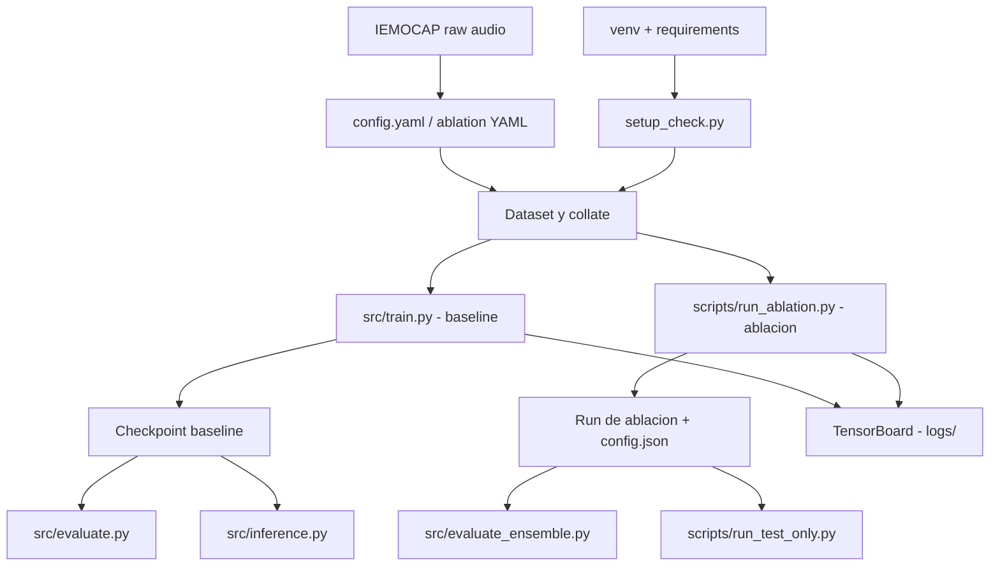

# Quickstart

Guía corta para poner en marcha **CONFORMER-SER** en Windows/PowerShell.
Visión general del proyecto: [README.md](README.md).

---

## 1. Flujo del proyecto



En los estudios **trimodales**, el log-mel que consume el ViT se calcula dentro del modelo a partir
del **mismo** waveform del batch; no hay mel precalculado en disco. Detalle en
[config/ablation/ABLATION_SUMMARY.md](config/ablation/ABLATION_SUMMARY.md), sección
*Datos de audio y rama visual*.

---

## 2. Requisitos

- **Python 3.8+**.
- **GPU CUDA** recomendada para entrenar (una ablación completa tarda horas).
- Dataset **IEMOCAP** descargado y extraído (`IEMOCAP_full_release`).
- Paquetes de [requirements.txt](requirements.txt), alineados con `setup_check.py`.

---

## 3. Instalación

```powershell
cd d:\DOCTORADO\PROYECTOS\CONFORMER-SER
python -m venv venv
.\venv\Scripts\Activate.ps1
pip install -r requirements.txt
python setup_check.py
```

Para CUDA, instala `torch` y `torchaudio` desde
[pytorch.org](https://pytorch.org/get-started/locally/) **antes** de `pip install -r requirements.txt`.

Atajo equivalente (instala y verifica en un solo paso):

```powershell
.\scripts\windows\setup.bat
```

`setup_check.py` valida Python, paquetes, CUDA, estructura del proyecto y ruta del dataset.

---

## 4. Configuración del dataset

Edita `config\config.yaml`:

```yaml
dataset:
  data_path: "D:\\ruta\\a\\IEMOCAP_full_release"
```

Los YAML de `config\ablation\` pueden sobrescribir esta ruta; si cambias de máquina, revisa también
el YAML del estudio que vayas a lanzar.

---

## 5. Entrenar

### Línea base

```powershell
python src\train.py --config config\config.yaml --experiment_name baseline --device cuda
```

### Ablación

```powershell
python scripts\run_ablation.py --study 45 --device cuda
```

Estudios válidos: **`1-50`** y **`52-63`**. **No existe el estudio 51.**
Catálogo completo: [config/ablation/ABLATION_SUMMARY.md](config/ablation/ABLATION_SUMMARY.md).

Los estudios **20, 29 y 41** ejecutan validación cruzada (K-Fold / LOSO) en lugar del split estándar.

---

## 6. Monitorear el entrenamiento

```powershell
tensorboard --logdir=logs
# o bien
.\scripts\windows\start_tensorboard.bat
```

Abre <http://localhost:6006>.

---

## 7. Evaluar

> [!IMPORTANT]
> `src\evaluate.py` **solo** reconstruye el modelo base (`ConformerMultimodalModel`). Con un
> checkpoint de ablación fallará: usa `src\evaluate_ensemble.py` o `scripts\run_test_only.py`.

### Checkpoint de la línea base

```powershell
python src\evaluate.py `
  --checkpoint checkpoints\best_model.pt `
  --config config\config.yaml `
  --split test --device cuda
```

### Checkpoint de ablación (YAML explícito)

```powershell
python src\evaluate_ensemble.py `
  --checkpoints checkpoints\ablation_34\run\best_model.pt `
  --configs config\ablation\ablation_34_conflict_aware_attention.yaml `
  --study_numbers 34 `
  --weights 1.0 `
  --split test `
  --output_dir evaluation_results\ablation_34 `
  --device cuda
```

### Solo test, sin reentrenar

Si ya tienes un run con `best_model.pt` y `config.json`:

```powershell
python scripts\run_test_only.py `
  --checkpoint_dir checkpoints\ablation_45\ablation_45_20260203_094355 `
  --study 45 --device cuda
```

También acepta la ruta directa al archivo:

```powershell
python scripts\run_test_only.py --checkpoint_dir checkpoints\ablation_45\run\best_model.pt --study 45 --device cuda
```

Escribe `final_results.json`, `confusion_matrix_test.png` y `test_eval.log` en el directorio del run.

### Agregar resultados de todos los runs

```powershell
python scripts\aggregate_ablation_results.py --write-docs
```

Regenera [docs/RANKING_Y_RESULTADOS.md](docs/RANKING_Y_RESULTADOS.md) a partir de los
`final_results.json` encontrados bajo `checkpoints/`.

---

## 8. Inferencia

`src\inference.py` está pensado para el modelo base:

```powershell
python src\inference.py `
  --checkpoint checkpoints\best_model.pt `
  --audio ruta\al\audio.wav `
  --text "Transcripción opcional"
```

---

## 9. Problemas frecuentes

| Síntoma | Causa habitual | Solución |
|---|---|---|
| `CUDA out of memory` | Batch demasiado grande para la GPU | Baja `training.batch_size` en el YAML (p. ej. a `4`) |
| Dataset no encontrado | `dataset.data_path` mal configurado | Revísalo en `config\config.yaml` **y** en el YAML de ablación |
| CUDA no disponible | `torch` instalado sin soporte CUDA | `python setup_check.py` y `nvidia-smi`; reinstala torch desde pytorch.org |
| Un checkpoint de ablación falla con `evaluate.py` | `evaluate.py` es solo para la línea base | Usa `evaluate_ensemble.py` o `run_test_only.py` |
| `Invalid study number` | Estudio fuera de rango o inexistente (51) | Rangos válidos: `1-50`, `52-63` |
| El YAML existe pero el estudio falla | Config huérfana sin ruta de código (p. ej. `ablation_65_*`) | Verifica en `scripts\run_ablation.py` |
| Falla el estudio 50 o 57 | Falta `funasr` (encoder Emotion2Vec) | `pip install funasr` |

---

## 10. Siguientes pasos

1. Leer [docs/ARCHITECTURE_AND_WORKFLOWS.md](docs/ARCHITECTURE_AND_WORKFLOWS.md).
2. Revisar [config/ablation/ABLATION_SUMMARY.md](config/ablation/ABLATION_SUMMARY.md).
3. Ejecutar una ablación corta o evaluar un checkpoint existente.
4. Comparar resultados con las matrices de confusión y los `final_results.json`.
