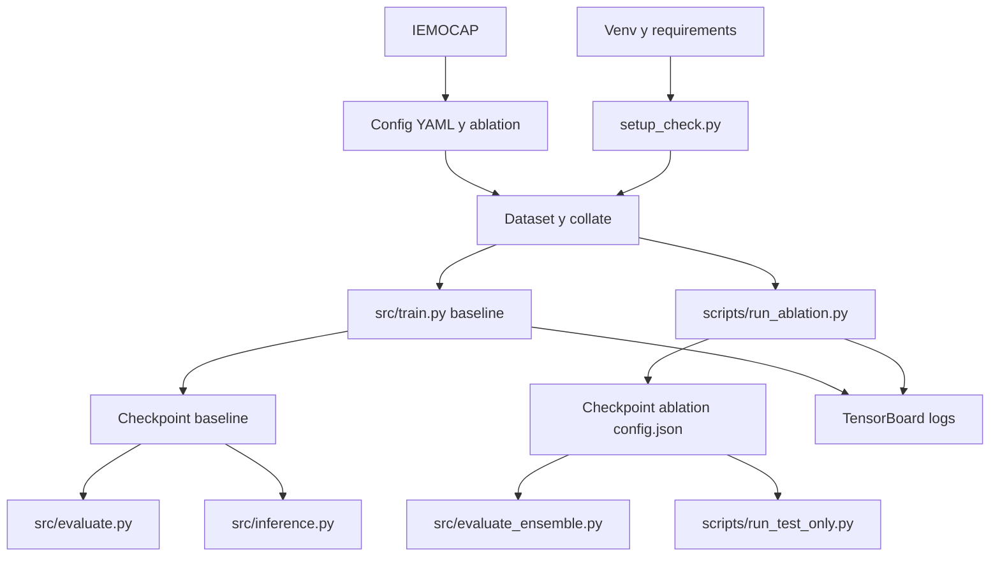

# Quickstart

Guía corta para ejecutar CONFORMER-SER en Windows/PowerShell.

## Flujo del proyecto (diagrama)



En estudios **trimodales**, el log-mel del ViT se calcula en el modelo a partir del **mismo** waveform del batch; no hay mel precalculado en el dataset. Detalle: [config/ablation/ABLATION_SUMMARY.md](config/ablation/ABLATION_SUMMARY.md) (sección *Datos de audio y rama visual*).

## Requisitos

- Python 3.8 o superior.
- GPU CUDA recomendada para entrenamiento.
- Dataset IEMOCAP descargado y extraído.
- Dependencias de `requirements.txt`.

## Instalación

```powershell
cd d:\DOCTORADO\PROYECTOS\CONFORMER-SER
python -m venv venv
.\venv\Scripts\Activate.ps1
pip install -r requirements.txt
python setup_check.py
```

También puedes ejecutar:

```powershell
.\setup.bat
```

`setup_check.py` valida Python, paquetes, CUDA, estructura del proyecto y ruta del dataset.

## Configuración del dataset

Edita `config\config.yaml`:

```yaml
dataset:
  data_path: "D:\\ruta\\a\\IEMOCAP_full_release"
```

Los YAML de `config\ablation\` pueden sobrescribir esta ruta si defines un estudio específico.

## Entrenar

### Baseline

Usa este flujo para el modelo principal definido por `config\config.yaml`:

```powershell
python src\train.py --config config\config.yaml --experiment_name baseline --device cuda
```

### Ablación

Usa este flujo para experimentos de investigación:

```powershell
python scripts\run_ablation.py --study 34 --device cuda
```

Estudios disponibles en el listado actual: `1-50, 52, 53, 54`. El estudio 51 no está definido.

Consulta el catálogo:

```powershell
notepad config\ablation\ABLATION_SUMMARY.md
```

## Monitorear entrenamiento

```powershell
tensorboard --logdir=logs
```

O:

```powershell
.\start_tensorboard.bat
```

## Evaluar

### Checkpoint baseline

`src\evaluate.py` está orientado al modelo base (`ConformerMultimodalModel`):

```powershell
python src\evaluate.py --checkpoint checkpoints\best_model.pt --config config\config.yaml --split test --device cuda
```

### Checkpoint de ablación

Para una ablación concreta con YAML explícito:

```powershell
python src\evaluate_ensemble.py `
  --checkpoints checkpoints\ablation_34\run\best_model.pt `
  --configs config\ablation\ablation_34_conflict_aware_attention.yaml `
  --study_numbers 34 `
  --weights 1.0 `
  --split test `
  --output_dir evaluation_results\ablation_34 `
  --device cuda
```

### Solo test sin reentrenar

Si ya tienes un run con `best_model.pt` y `config.json`:

```powershell
python scripts\run_test_only.py --checkpoint_dir checkpoints\phase1_wavlm_gated\ablation_34_20260203_094355 --study 34 --device cuda
```

También acepta la ruta directa al archivo:

```powershell
python scripts\run_test_only.py --checkpoint_dir checkpoints\ablation_34\run\best_model.pt --study 34 --device cuda
```

El script guarda `final_results.json`, `confusion_matrix_test.png` y `test_eval.log` en el directorio del run.

## Inferencia

`src\inference.py` está pensado para el modelo base:

```powershell
python src\inference.py --checkpoint checkpoints\best_model.pt --audio path\to\audio.wav --text "Transcripción opcional"
```

## Problemas frecuentes

### Out of memory

Reduce el batch size:

```yaml
training:
  batch_size: 4
```

### Dataset no encontrado

Revisa `dataset.data_path` en `config\config.yaml` y en el YAML de ablación que estés usando.

### CUDA no disponible

Verifica:

```powershell
python setup_check.py
nvidia-smi
```

### Checkpoint de ablación falla con `evaluate.py`

Usa `src\evaluate_ensemble.py` o `scripts\run_test_only.py`. `src\evaluate.py` reconstruye el modelo base y no todas las clases de `src\ablation_studies`.

## Siguientes pasos

1. Leer [docs/ARCHITECTURE_AND_WORKFLOWS.md](docs/ARCHITECTURE_AND_WORKFLOWS.md).
2. Revisar [config/ablation/ABLATION_SUMMARY.md](config/ablation/ABLATION_SUMMARY.md).
3. Ejecutar una ablación corta o evaluar un checkpoint existente.
4. Comparar resultados con las matrices de confusión y `final_results.json`.

